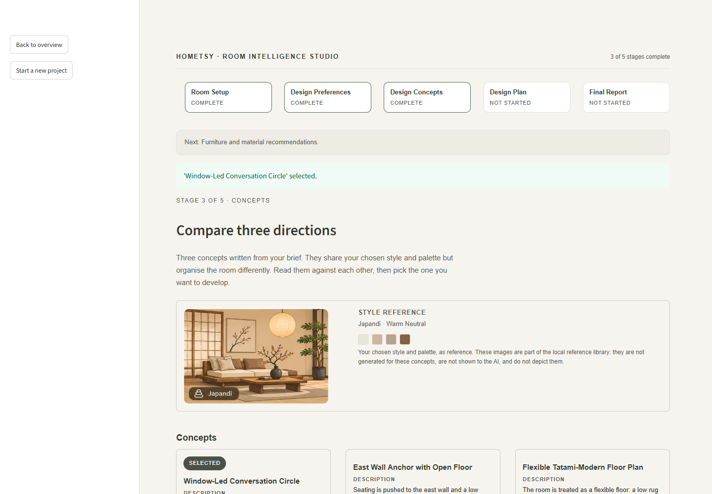
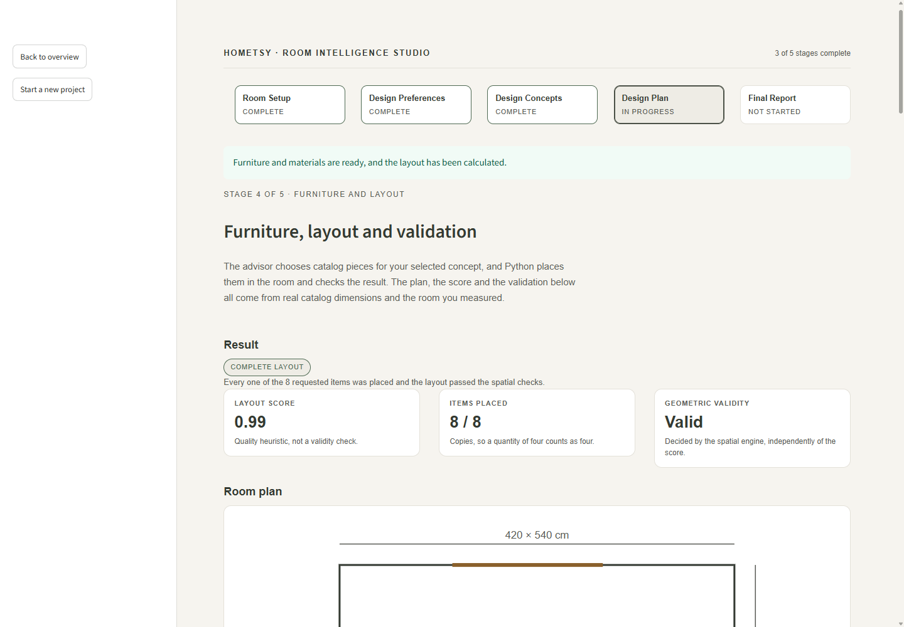
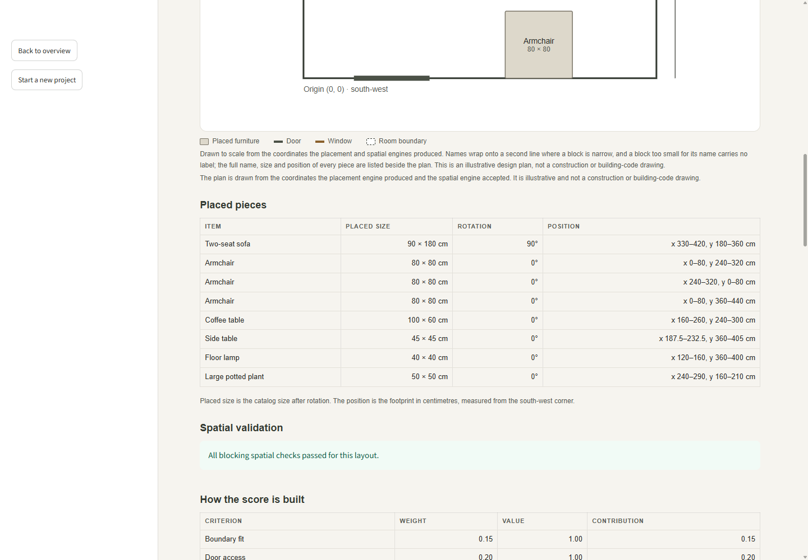

# HOMETSY — Room Intelligence Studio

An AI-assisted interior design and spatial planning application for a single
rectangular room. You enter the room, a design direction and a budget; the
application analyses the brief, proposes three design concepts, recommends
furniture from a local catalog, draws a dimensioned 2D plan with deterministic
geometric validation, prices the result, and exports a professional PDF report.

The project is a portfolio piece, not a commercial product. Its purpose is to
demonstrate a clean split between language-model reasoning and deterministic
engineering: the model interprets and writes, Python measures and calculates.

---

## Table of contents

- [What it does](#what-it-does)
- [Screenshots](#screenshots)
- [Architecture](#architecture)
- [The AI / Python split](#the-ai--python-split)
- [Technology stack](#technology-stack)
- [Installation](#installation)
- [Configuration](#configuration)
- [Running the application](#running-the-application)
- [Workflow](#workflow)
- [Tests](#tests)
- [Data and assets](#data-and-assets)
- [Known limitations](#known-limitations)
- [Roadmap](#roadmap)
- [Documentation](#documentation)

---

## What it does

The V1 journey has five stages, shown in the application shell on every screen:

| Stage | What happens |
|---|---|
| **1 · Room Setup** | Rectangular room dimensions in centimetres, one door and one window with wall and offset. Validated before anything is stored. |
| **2 · Design Preferences** | One of six design styles, one of four palette directions, free-text requirements, optional materials and a budget limit. |
| **3 · Design Concepts** | The AI analyses the brief into a structured summary, then writes three distinct concepts. You select one. |
| **4 · Design Plan** | The AI recommends catalog items; Python places them, checks boundaries and overlaps, scores the layout, prices the basket and evaluates the design. |
| **5 · Final Report** | An A4 PDF covering the overview, brief, concept, furniture and materials, the validated plan, the spatial verdict, the budget, the AI evaluation and the limitations. |

Concretely:

- **Room input is validated, not trusted.** Dimensions are range-checked, the
  door and window must sit inside their wall, and the window must leave the
  room's area usable.
- **Furniture is real.** Every recommendation is checked against the local
  catalog; an item the catalog does not contain is rejected rather than drawn.
- **The plan is drawn from real dimensions.** A 220 × 90 cm sofa is placed using
  220 × 90 cm, rotation included, and the block in the drawing is that footprint.
- **Placement is deterministic.** Boundary and overlap checks, door access,
  window clearance and circulation are computed in Python from the placed
  footprints. The model never decides whether furniture fits.
- **The budget is arithmetic.** Unit costs come from the catalog, quantities
  multiply them, and the total, remaining budget and overrun are `Decimal`
  arithmetic in Python.
- **An unpriced item is reported, never costed at zero.** Materials have no
  price list in V1, so they are listed as *not priced* and excluded from the
  furniture total.
- **A partial or failed layout is presented as such.** If only some items fit,
  the plan is labelled partial and the unplaced items are named as not in the
  room. If the placement engine rejects the candidate, no plan is drawn — the
  screen does not show furniture that was refused.
- **A failed AI call never becomes a result.** Truncated, malformed or
  schema-invalid model output is an error on screen, not a fabricated success.

### Supported room types

Living Room, Bedroom, Home Office, Dining Room.

### Design styles and palettes

Six styles: Scandinavian, Contemporary, Industrial, Bohemian, Warm Minimalism,
Japandi. Four palette directions: Warm Neutral, Earthy, Cool Modern, Natural
Materials.

Both libraries are local. Each style and palette has a reference image and a
text description; the description is what reaches the model.

---

## Screenshots

All screenshots are captured from the running application. They are not mockups.

| | |
|---|---|
|  |  |
| **Landing** — the five-stage journey and an honest roadmap | **Room setup** — validated centimetre input |
|  |  |
| **Design preferences** — six styles, four palettes, budget | **Project review** — everything the AI will receive |
|  |  |
| **Design concepts** — three directions to compare | **Concept selected** — the chosen direction |
|  |  |
| **Design plan** — furniture, layout and validation | **Plan drawing** — dimensioned, to scale |
|  |  |
| **Spatial validation** — what the engine decided | **Design evaluation** — the AI critique |
|  |  |
| **Budget analysis** — deterministic arithmetic | **Final report** — the PDF is ready to download |

Mobile layouts are included as
[plan at 390 px](docs/screenshots/19-plan-mobile-390.png) and
[budget at 390 px](docs/screenshots/20-budget-mobile-390.png).

A ten-image presentation selection is in
[`docs/screenshots/portfolio/`](docs/screenshots/portfolio/), in narrative order,
with its rationale in
[`reports/portfolio-release/SCREENSHOT_SELECTION.md`](reports/portfolio-release/SCREENSHOT_SELECTION.md).

---

## Architecture

A single Streamlit process. Layers depend downward; nothing in `core`, `ai`,
`models` or `workflow` imports Streamlit.

```
app.py                      Streamlit entry point, screen routing
│
├── ui/                     Presentation and Streamlit adaptation
│   ├── shell.py            brand bar, stage strip, stage vocabulary
│   ├── theme.py            the single stylesheet and the colour tokens
│   ├── session.py          one WorkflowState per browser session
│   ├── pages_*.py          one module per screen
│   ├── diagram.py          room and plan SVGs
│   ├── ai_actions.py       the only place AI services are invoked
│   └── commits.py          validate → store → invalidate downstream
│
├── workflow/               State machine (no Streamlit)
│   ├── state.py            WorkflowState, completion, invalidation
│   └── dependencies.py     what each step depends on
│
├── core/                   Deterministic engines (no Streamlit, no AI)
│   ├── room_engine.py      room geometry and openings
│   ├── placement_engine.py furniture placement
│   ├── spatial_engine.py   boundary, overlap, access, circulation
│   ├── budget_engine.py    Decimal arithmetic over the catalog
│   ├── validation.py       shared validation helpers
│   └── report_generator.py the A4 PDF (ReportLab)
│
├── ai/                     Model access (no Streamlit)
│   ├── config.py           endpoint, model, credential resolution
│   ├── client.py           HTTP transport, typed errors
│   ├── prompt.py           prompt assembly and schema enforcement
│   ├── parsing.py          structured-output parsing and repair
│   ├── brief_analyzer.py   operation 1
│   ├── concept_generator.py operation 2
│   ├── design_advisor.py   operation 3
│   └── design_evaluator.py operation 4
│
├── models/schemas.py       Pydantic models shared by every layer
├── data/                   catalog and reference library (JSON)
└── tests/                  1,149 tests
```

### Why the layers are separated

`workflow` is the single source of truth for *what the user has done*. Step
completion is **derived** from the presence of data plus its prerequisites, not
stored as flags, so editing the budget cannot leave a stale "complete" flag
behind: the downstream results are cleared and the derived state reflects it.

`core` never calls AI, and `ai` never does geometry, money or drawing. The
`ui` layer is the only one that knows Streamlit exists.

### Invalidation

Changing an upstream input clears exactly the downstream work that depended on
it. Change the budget limit and the stored budget analysis is discarded; change
the concept selection and the plan, evaluation and budget go with it. A retained
result is never shown as current.

---

## The AI / Python split

This is the central design decision of the project.

**The model is used for four things, and only these four:**

| Operation | Model produces | Python then |
|---|---|---|
| Brief analysis | A structured summary: objectives, constraints, opportunities, open questions | Validates the schema and stores it |
| Concept generation | Three concepts: name, rationale, spatial strategy, palette, key pieces | Validates count, distinctness and catalog plausibility |
| Furniture recommendation | Catalog item IDs, quantities, a reason per item, materials | Checks every ID against the catalog, places them, validates geometry |
| Design evaluation | A critique: strengths, risks, recommendations | Keeps the layout, score and prices it computed itself |

**Python owns every number.** Room area, wall lengths, opening positions,
furniture footprints, rotation, boundary and overlap checks, clearances, the
layout score, unit costs, subtotals, the total, the remaining budget and the
overrun. None of these is delegated to the model, and none of the model's output
can override them.

**The model's output is never trusted.** Every response is parsed into a
Pydantic schema. A missing field, wrong type, unknown catalog item, duplicate
concept or truncated response is a typed error that surfaces on screen. The
application does not repair a bad answer into a plausible one, and it does not
store anything it could not validate.

**What the model does not receive.** It never sees the reference image files.
The images are illustrative and local; only their textual descriptions and
category identifiers are sent. The application does not claim to analyse images,
because the model cannot.

---

## Technology stack

| Layer | Choice |
|---|---|
| Language | Python 3.13 |
| Interface | Streamlit 1.67 |
| Validation | Pydantic 2 |
| Charts | Matplotlib 3 |
| PDF | ReportLab 4 |
| Tests | pytest 9 |
| Model | `deepseek-ai/deepseek-v4.1-flash-1017` via an OpenAI-compatible endpoint |

No other runtime dependency is used. The spatial engines, the SVG diagrams and
the budget arithmetic use the Python standard library.

---

## Installation

Requires Python 3.13 or newer.

```bash
python -m venv .venv

# Windows
.venv\Scripts\activate
# macOS / Linux
source .venv/bin/activate

pip install -r requirements.txt
```

---

## Configuration

The AI layer needs one credential. It is read from the environment:

```bash
# Windows (PowerShell, current session)
$env:DEPLOY_API_KEY = "your-key-here"

# macOS / Linux
export DEPLOY_API_KEY="your-key-here"
```

Alternatively, provide it through Streamlit's secret store. Create
`.streamlit/secrets.toml`:

```toml
DEPLOY_API_KEY = "your-key-here"
```

`.streamlit/secrets.toml` is excluded from version control and must never be
committed.

The endpoint and model are configuration, not secrets, and live in
`ai/config.py`. The credential is excluded from `repr` and from every error
message, so a logged exception cannot leak it.

**Without a key the application still runs.** Room setup, preferences, review,
the budget and the PDF's deterministic sections all work; the AI buttons report
that the service is not configured instead of failing silently. The test suite
never needs a key.

### Interface appearance

`.streamlit/config.toml` pins the light theme, the palette and the base font
size so a fresh clone renders identically. The application stylesheet lives in
`ui/theme.py`.

---

## Running the application

```bash
streamlit run app.py
```

Then open the URL Streamlit prints (by default `http://localhost:8501`).

To use a different port:

```bash
streamlit run app.py --server.port 8512
```

Typical journey: **Start Room Setup →** enter the room → choose a style,
palette and budget → review → **Analyse the brief** → **Generate three
concepts** → select one → **Recommend furniture and build the plan** →
**Evaluate the design** → **Continue to budget analysis** → **Continue to the
final report** → **Generate the PDF report**.

The PDF is written to `output/reports/`.

---

## Workflow

The shell shows five stages and the page beneath names the stage it belongs to
(`Stage 3 of 5 · Concepts`). The bar counts the same five stages, so the bar and
the page cannot disagree.

Each step is complete only when its own data exists **and** its prerequisites are
complete. Editing an upstream input invalidates the downstream steps that depend
on it:

| Change | Invalidates |
|---|---|
| Room dimensions, door or window | Brief, concepts, selection, plan, evaluation, budget |
| Style, palette, requirements, materials | Brief, concepts, selection, plan, evaluation, budget |
| Budget limit | Budget analysis |
| Concept selection | Plan, evaluation, budget |
| Recommended furniture | Plan, evaluation, budget |

Navigation is forward-only where a step depends on its predecessor, but you can
always return to an earlier screen and change your mind.

---

## Tests

```bash
.venv\Scripts\python.exe -X utf8 -m pytest -q
```

At the time of writing: **1,149 passed, 0 failed, 0 skipped.**

The suite is organised by layer:

| Area | Files |
|---|---|
| Schemas and validation | `test_models.py`, `test_validation.py` |
| Geometry and engines | `test_room_engine.py`, `test_placement_engine.py`, `test_spatial_engine.py` |
| Budget | `test_budget_engine.py` |
| AI layer (mocked) | `test_ai_client.py`, `test_ai_config.py`, `test_ai_parsing.py`, `test_ai_prompt.py`, `test_ai_services.py` |
| Workflow state | `test_workflow_state.py`, `test_workflow_dependencies.py`, `test_workflow_integration.py` |
| Interface, end to end | `test_ui_app.py`, `test_ui_layout.py`, `test_ui_presentation.py`, `test_ui_headings.py`, `test_ui_session.py`, `test_ui_commits.py`, `test_ui_ai_flow.py`, `test_ui_advisor_flow.py`, `test_ui_evaluation.py`, `test_ui_budget.py`, `test_ui_report.py` |
| PDF | `test_report_generator.py` |

The AI tests use recorded and constructed responses, so **the suite never
requires a live API key** and never makes a network call. The UI tests load the
real `app.py` in Streamlit's own `AppTest` harness rather than mocking the
framework.

---

## Data and assets

### Furniture catalog

`data/furniture_catalog.json` holds 20 items across seating, tables, storage,
lighting, rugs, plants and textiles. Each item has a category, real dimensions in
centimetres, an **indicative** unit cost, the room types it suits and a drawing
shape.

The costs are illustrative figures for a portfolio project. They are **not**
verified current market prices, not retailer data and not a quotation. The
interface and the PDF both say so.

### Reference library

`data/design_references.json` maps the six styles and four palettes to local
images under `assets/images/` and to the text descriptions that are sent to the
model.

The images are **original AI-generated reference sheets created for this
project**; no third-party stock photography is used. They are illustrative design
inspiration, not photographs of verified products or completed rooms. The
provenance, the applied corrections and the two excluded source assets are
recorded in:

- `assets/source_pack/asset_manifest.json`
- `data/asset_replacements.json`

The images were produced with **ChatGPT ImageGen** for this project. The manifest
records a note to review applicable platform terms before external redistribution;
that review was completed before publication, and all 23 images are included. No
third-party attribution is required, because no third-party asset is used. OpenAI
does not endorse or sponsor this project.

---

## Known limitations

These are deliberate V1 boundaries, not unfinished work:

- **One rectangular room.** No L-shapes, alcoves, columns or sloped ceilings.
- **One project per session.** No saved projects, accounts or database.
- **Indicative prices.** The catalog costs are illustrative. There is no live
  pricing and no retailer integration.
- **The 2D plan is illustrative.** It is drawn to scale from real coordinates,
  but it is not a construction or building-code drawing.
- **Basic geometric validation only.** Boundary fit, overlap, door access,
  window clearance and a heuristic circulation score. This is **not** a claim of
  ergonomic, accessibility, structural or building-code compliance.
- **Materials are not priced.** They are listed as *not priced* and excluded from
  the furniture total, because V1 has no material price list.
- **The model is text-only.** The reference images are never sent to it and it
  cannot analyse photographs.
- **Labels on very small blocks.** A block too small for its name on one or two
  lines carries no label; its full name, size and position are in the table
  beneath the plan, and the caption says so.
- **AI latency and capacity.** A slow or truncated model response is reported as
  an error and can be retried; it is not silently replaced.

### Accessibility

The interface is keyboard operable, has labelled controls, a skip link, visible
focus, one `h1` per screen with section headings as real `h2`/`h3`, landmarks,
alternative text on every image and both SVG diagrams, and a 4.5:1 minimum
contrast ratio for all text. Automated axe-core 4.10.2 scans report **zero
violations** on nine screens.

Two honest qualifications, both found during final review:

- **Axe is not sufficient for headings.** axe's `page-has-heading-one` rule
  reported a pass on a page that later turned out to have no `h1` at all, so the
  zero-violation result was never evidence about heading structure. The heading
  outline is now asserted directly by tests (`tests/test_ui_headings.py`) instead
  of being inferred from an axe pass.
- **No screen-reader listening session has been performed.** NVDA is not
  installed on the development machine and was deliberately not installed for
  this review. The accessibility tree a screen reader consumes was inspected
  directly (page titles, headings, form labels, buttons, status messages, concept
  selection, spatial results, report download), and the heading defect that
  inspection found was fixed. That is structural evidence, **not** a substitute
  for listening to a screen reader, and this project does not claim screen-reader
  compatibility or WCAG conformance. See
  `reports/portfolio-release/RELEASE_READINESS.md`.

### Responsive layout

Measured in a real browser at 1440, 1024, 768, 430, 404, 390 and 360 px wide: the
page never scrolls horizontally at any of those widths. On narrow screens the
plan drawing keeps its full scale and scrolls inside its own focusable frame
rather than shrinking its labels below legibility.

---

## Roadmap

V1 is the only version implemented.

### V1 — Core Room Intelligence Workflow *(complete)*

Rectangular room setup, design preferences, AI brief analysis, three AI
concepts, concept selection, furniture and material recommendations, a local
catalog, a dimensioned 2D plan, basic spatial validation, deterministic budget
analysis, AI design evaluation and a PDF report.

### V2 — Visual Understanding *(planned, not implemented)*

Room photograph analysis, image-based style extraction, AI-generated concept
imagery and additional layout alternatives. These need a vision-capable model
and an image pipeline that V1 deliberately does not have.

### V3 — Advanced Spatial Planning *(planned, not implemented)*

3D visualisation, multi-room planning, product catalog integration with live
pricing and advanced spatial optimisation.

---

## Documentation

| Document | Contents |
|---|---|
| `PROJECT_BRIEF.md` | Product scope and requirements |
| `TECHNICAL_ARCHITECTURE.md` | Architecture and layer contracts |
| `DESIGN_SYSTEM.md` | Visual direction, palette, typography, components |
| `DEVELOPMENT_PLAN.md` | The phased development plan |
| `AGENTS.md` | Engineering and quality rules |
| `COPYRIGHT.md` | Proprietary rights notice and third-party attribution |
| `reports/` | Per-phase completion, test and readiness reports |
| `docs/PORTFOLIO_CASE_STUDY.md` | Portfolio case study: problem, architecture, engineering decisions, QA evidence |

---

Built as a portfolio project. The interesting part is not that a model can write
about interior design — it is where the model stops and the engineering starts.
