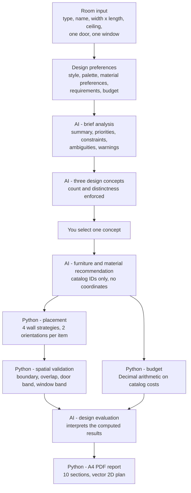
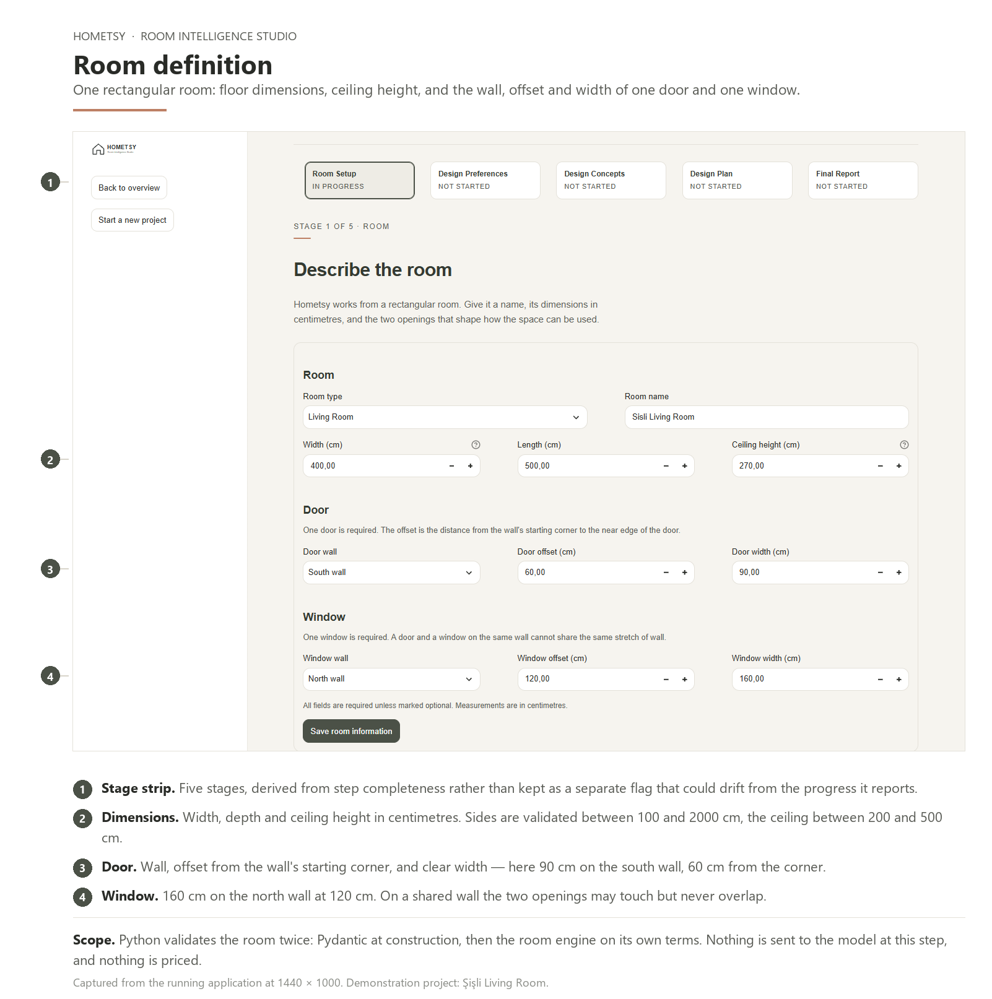
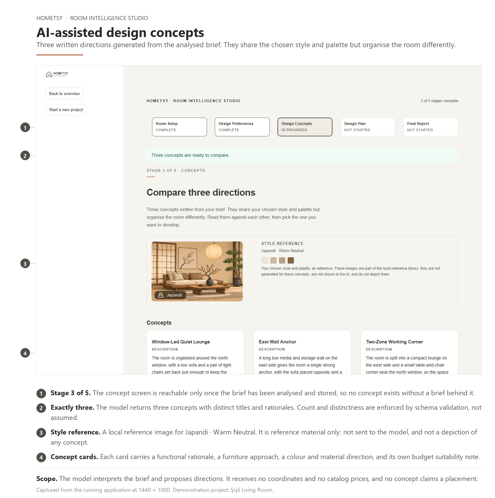
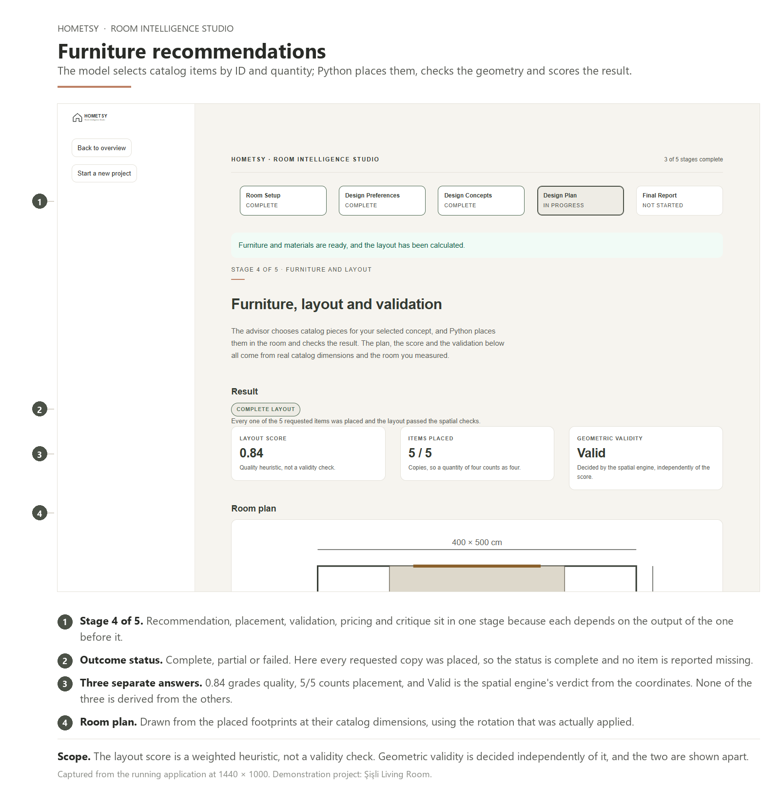
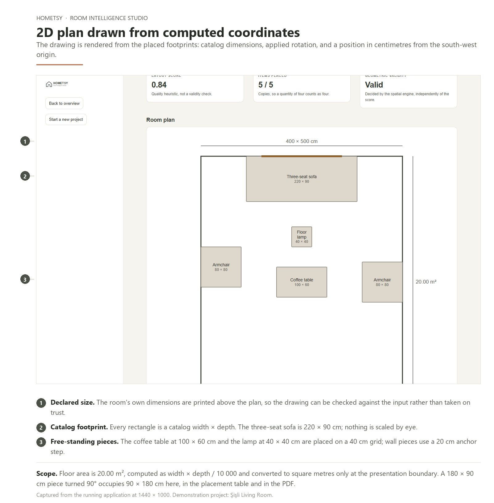
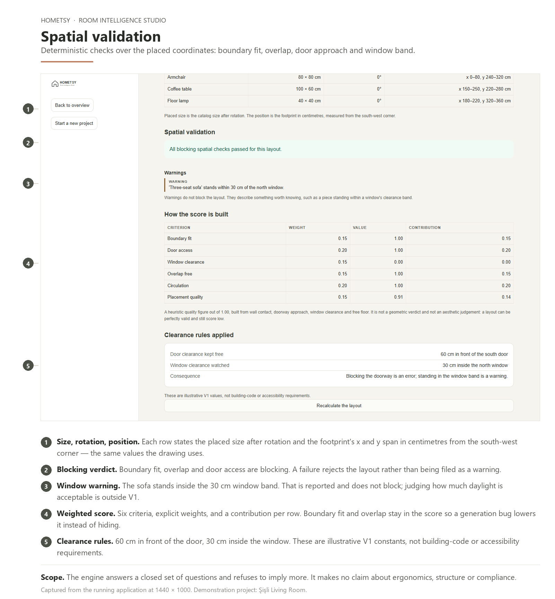
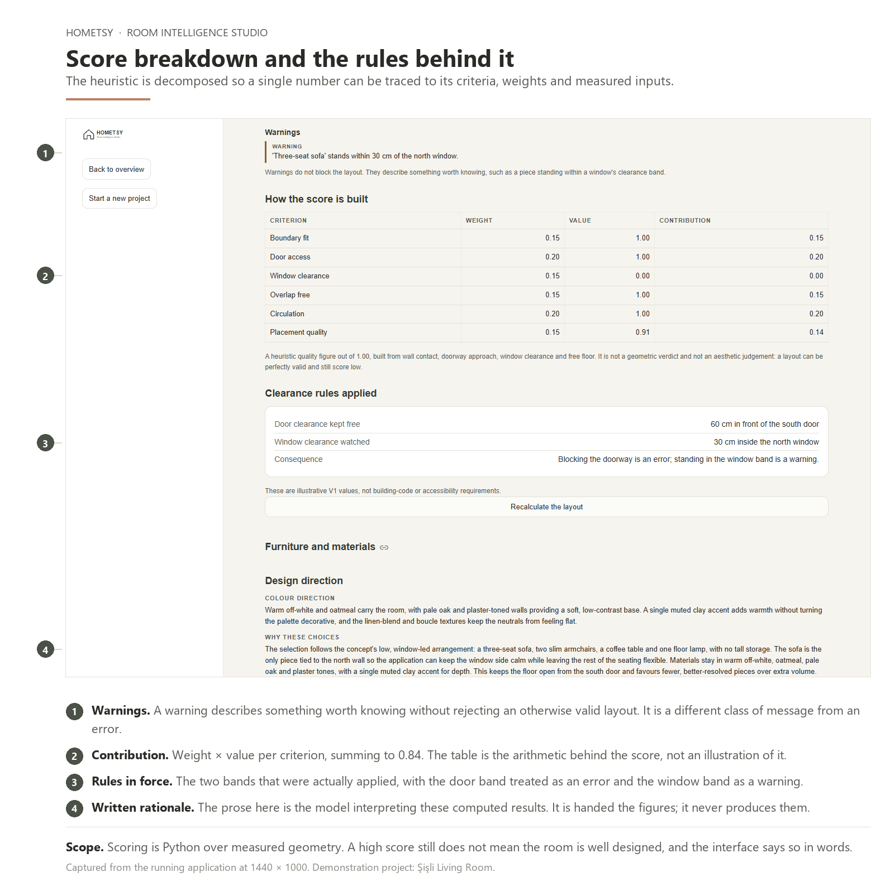
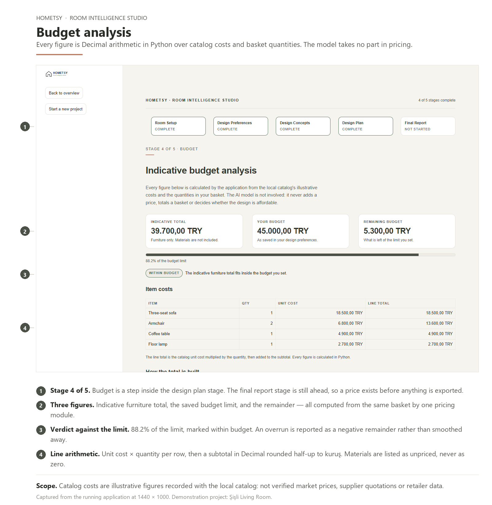

# HOMETSY — Room Intelligence Studio

**V1 · AI-assisted, single-room interior design with deterministic spatial and budget control**

Planning a room means settling several questions at once: what the space must
do, how it should look, which furniture fits, and whether any of it can be
afforded. Those answers are usually produced separately — a mood board here, a
sketched layout there, a spreadsheet somewhere else — so nobody checks whether
the sofa they liked is 220 cm wide and the wall is 180 cm. A general chat model
does not fix this. It will describe a layout fluently without ever measuring
one.

HOMETSY turns one rectangular room and a stated budget into a structured design
proposal, and it keeps the measurable part measurable. The AI model interprets
the brief, proposes design directions, recommends catalog items and writes a
critique. Python measures the room, places the furniture, checks the geometry,
prices the basket and draws the plan. The model never sees a coordinate and
never produces a total.

The product exists to demonstrate that division of labour end to end, in a
working application with tests, not as an architectural diagram.

- Repository: <https://github.com/mertkk1623/HOMETSY-STUDIO>
- Version: V1 (the only version implemented)
- Nature: portfolio project, single user, single room, local data

---

## Contents

- [A. Project overview](#a-project-overview)
- [B. The problem](#b-the-problem)
- [C. Product workflow](#c-product-workflow)
- [D. Core capabilities](#d-core-capabilities)
- [E. Engineering and operational logic](#e-engineering-and-operational-logic)
- [F. Visual walkthrough and outputs](#f-visual-walkthrough-and-outputs)
- [G. Validation and reliability](#g-validation-and-reliability)
- [H. Current scope and limitations](#h-current-scope-and-limitations)
- [I. Roadmap](#i-roadmap)
- [J. Technical implementation](#j-technical-implementation)
- [K. Running the application](#k-running-the-application)

---

## A. Project overview

HOMETSY is a Streamlit application that takes a room description — type, name,
width, length, ceiling height, one door and one window — together with a design
style, a colour palette, optional material preferences, free-text requirements
and a total budget, and walks that input through a fixed ten-step workflow to a
downloadable PDF design report.

The workflow is fixed and forward-moving, with five user-facing stages:

1. **Room Setup** — describe the room and its two openings.
2. **Design Preferences** — choose a style, a palette, optional material
   preferences, requirements and a budget.
3. **Design Concepts** — the AI analyses the brief, proposes exactly three
   concepts, and you select one.
4. **Design Plan** — the AI recommends catalog furniture and materials, Python
   places and validates the layout, prices it, and the AI evaluates the result.
5. **Final Report** — the project is finalised and exported as an A4 PDF.

What makes the application worth reading is not the wizard. It is the contract
between the two halves of the system:

| | AI model | Deterministic Python |
|---|---|---|
| Interprets the brief | yes | — |
| Proposes three design directions | yes | — |
| Selects catalog items by ID with a reason | yes | — |
| Writes the design critique | yes | — |
| Assigns coordinates | never | always |
| Measures area, boundaries, overlaps | never | always |
| Decides whether the layout is valid | never | always |
| Computes prices, subtotals, overrun | never | always |
| Renders the 2D plan and the PDF | never | always |

Every row in the right-hand column is covered by unit tests that do not require
an API key. The AI rows are covered by tests that replay recorded responses.

---

## B. The problem

A residential room design proposal has to answer five questions that are easy to
state and easy to get wrong:

- **Fit.** Does the furniture physically fit, including the door swing and the
  walkway to it?
- **Coherence.** Do the pieces, materials and palette belong to one direction
  rather than three?
- **Requirements.** Does the proposal actually serve what the occupant asked
  for — storage, a workspace, seating for guests?
- **Money.** What does the basket cost against the stated limit, line by line?
- **Accountability.** Can any of the above be checked, or is it only prose?

The last question is the difficult one. Text generated by a language model is
fluent, plausible and under no obligation to be arithmetically true. A sentence
claiming a three-seat sofa suits a 180 cm wall reads exactly like a correct one.
Without a measuring layer, a design proposal cannot be verified even by the
person who commissioned it.

HOMETSY's approach is to make the measurable claims machine-checkable and to
confine the model to the parts that genuinely need interpretation: reading
intent out of a short brief, generating genuinely different directions,
choosing from a fixed catalog, and critiquing a result it did not compute. The
geometry and the arithmetic are ordinary, inspectable Python with tests, so a
disagreement between the plan and the description is a bug with a location, not
a matter of opinion.

This is a demonstration of a design-planning workflow. It is not a substitute
for an architect or an interior designer, and it makes no claim about
professional practice.

---

## C. Product workflow

### The path through the application



The two arrows leaving the recommendation step are the point of the design: the
layout and the price are computed independently from the same basket, and the
evaluation only runs once both exist. It cannot critique a total that has not
been calculated.

### Stages, screens and steps

The interface shows five stages. Internally the workflow tracks ten steps, so a
stage can span several of them; the stage strip is derived from step
completeness rather than kept as a separate flag that could drift.

| Stage | Screens | What happens | Owner |
|---|---|---|---|
| Room Setup | Room information | Room type, name, dimensions, ceiling, door and window with wall, offset and width | Python validation |
| Design Preferences | Design preferences, Project input review | Style, palette, optional material preferences, requirements, budget; a review screen shows exactly what later steps will use | Python validation |
| Design Concepts | Design brief, Design concepts | Brief analysis, then three concepts, then your selection | AI, then you |
| Design Plan | Design plan, Design evaluation, Budget analysis | Recommendations, placement, validation, pricing and critique | AI + Python |
| Final Report | Final report | Finalise the project and generate the PDF | Python |

### Invalidation: what a change discards

Editing an upstream input clears the results that depended on it. The rules live
in one table (`workflow/dependencies.py`) and nowhere else; a second copy in a
screen would eventually disagree with the first.

| Change | Clears |
|---|---|
| Room dimensions or room type | Brief, concepts, selection, furniture, materials, layout, budget analysis, evaluation |
| Door or window | Brief, concepts, selection, furniture, materials, layout, evaluation (not the budget analysis) |
| Style, palette, material preferences, requirements | Brief, concepts, selection, furniture, materials, evaluation |
| Budget limit | Brief, concepts, furniture, materials, budget analysis, evaluation (not the selection or the layout) |
| Selected concept | Furniture, materials, layout, budget analysis, evaluation |
| Recommended furniture | Layout, budget analysis, evaluation |
| Materials | Budget analysis, evaluation (not the layout) |
| Layout or budget analysis | Evaluation |

Two of these are worth noting because they look like omissions and are not. A
door width does not change what a sofa costs, so an opening edit leaves the
price alone. And a material palette carries no geometry in V1, so changing it
does not discard a validated layout.

---

## D. Core capabilities

### Room and requirement definition

Four room types (living room, bedroom, home office, dining room), each with its
own catalog subset. Sides are validated between 100 cm and 2000 cm, ceiling
height between 200 cm and 500 cm, and an opening must be at least 40 cm wide and
fit entirely on its wall. Exactly one door and one window are required; on a
shared wall they may touch but not overlap. Everything is entered in
centimetres; floor area is shown in square metres.

Requirements are a list of short entries plus an optional free-text notes field;
material preferences are a separate optional list of up to ten entries. They are
text for the brief, not catalog selections — the catalog basket comes later from
the advisor.

### AI-assisted brief analysis

**Input:** room facts, style, palette, requirements, budget.
**Output:** a structured brief with a summary, functional priorities,
constraints, ambiguities and warnings.
**Then:** Pydantic validates the shape before anything is stored. A malformed
answer gets one correction request; if it is still invalid the operation reports
an error rather than storing a partial brief. The brief describes the request;
it does not design the room or choose furniture.

### Design concept generation

**Input:** the analysed brief plus your preferences.
**Output:** exactly three concepts, each with a name, description, design
direction, colour and material direction, furniture approach and functional
rationale. The count is fixed at three in the schema, and duplicate concept
names are rejected, so the choice is between three different directions rather
than three copies of one.

### Furniture and material recommendations

**Input:** the selected concept, the brief and the catalog.
**Output:** catalog item IDs with quantities and a reason per item, plus a
material palette with a rationale and a colour direction. The advisor is
explicitly instructed not to assign positions, coordinates or wall placements.
Every catalog ID is checked afterwards against the local catalog and against
the room type's supported subset; an unknown or unsuitable reference is
reported, never silently dropped or silently accepted.

### Deterministic furniture placement

**Input:** the recommendation basket, the room, the openings, the catalog.
**Output:** a layout with real coordinates for every placed copy, plus a status:
complete, partial, or failed. The 20-item catalog supplies the real dimensions;
rotation is a hint that produces two candidate orientations per item.

### Spatial validation

**Input:** the placed footprints and the room.
**Output:** a verdict plus three lists — boundary violations, overlaps and
warnings. The verdict is produced by the spatial engine alone; the placement
score is never treated as a substitute for it.

### Budget analysis

**Input:** the basket and the budget limit.
**Output:** a line-item estimate, a furniture subtotal, an explicit
material-subtotal position, the total, the remaining budget and an over-budget
flag. All arithmetic is `Decimal` at kuruş precision.

### Design evaluation

**Input:** the brief, the selected concept, the recommended items, and the
spatial and budget results Python already computed.
**Output:** six fields of prose — requirement compatibility, style consistency,
functional suitability, budget suitability, limitations, recommendations. The
evaluator is told not to recompute, re-round or contradict the figures it was
given.

### PDF reporting

**Input:** the finalised project.
**Output:** an A4 PDF with a cover plus nine body sections (letters B–J) —
overview, brief, concept, furniture and materials, plan, spatial validation,
budget, evaluation, and the limitations and disclaimer.

---

## E. Engineering and operational logic

This section states the rules the application actually applies. They are the
rules the tests assert, not an intended design.

### 1. Room model and coordinate system

All internal measurement is in centimetres. The origin is the south-west
(bottom-left) corner: `width` extends east along +x, `length` extends north
along +y. Opening offsets follow the same convention — measured from the west
end on the south and north walls, from the south end on the west and east
walls.

Floor area is `width × length / 10 000`, converted to square metres only at the
presentation boundary. Comparisons use a floating-point tolerance of 1e-6 cm,
so a shared edge is a shared edge rather than a 1e-9 overlap.

Validation of the room itself is deliberately done twice: Pydantic rejects
obviously invalid models at construction, and the room engine re-checks the
values on their own terms, because it does not assume the caller built a valid
model.

### 2. Door and window positioning

Each opening is a wall, an offset and a width. Each produces a rectangle of
clearance in front of it:

| Opening | Clearance depth | Consequence if a footprint intrudes |
|---|---|---|
| Door | 60 cm | Blocking error — the layout is invalid |
| Window | 30 cm | Warning only — the layout remains valid |

These depths are illustrative V1 constants. They are not building-code,
accessibility or ergonomic requirements, and the code says so in the module
docstring, the interface and the PDF.

The asymmetry is intentional. A blocked doorway makes the room unusable in a
way the application can judge. A window is partly obstructed by many ordinary
layouts, and judging how much daylight is acceptable is not something this
application can do, so it reports rather than rejects.

### 3. Furniture dimensions and placement

The catalog holds 20 items in seven categories (seating, tables, storage,
sleeping, lighting, decor, textiles), each with real width and depth in
centimetres, an indicative unit cost, the room types it suits, and a drawing
shape. Placement uses those dimensions directly; nothing is estimated from a
picture.

The placement algorithm is small on purpose, and single-pass:

1. Resolve every recommendation against the catalog by ID. An unknown ID
   becomes an unplaced item with a stated reason — never a silently dropped
   row, never a guess.
2. For each of four wall-preference strategies — north-first, east-first,
   south-first, west-first — place the items greedily, largest footprint first,
   because the largest piece has the fewest valid positions.
3. For each item, try the requested orientation and its quarter turn, and keep
   the better-scoring one. The orientation actually used is stored on the
   footprint, so the plan and the table agree.
4. Score each complete candidate layout and take the best.

Candidate positions are generated on fixed steps — a 20 cm anchor step along
walls for wall pieces, a 40 cm grid for free-standing pieces — rather than
optimised continuously. That is a deliberate V1 limitation, not an oversight:
a bounded, reproducible search is easier to test and to explain than an
optimiser, and its output can be re-derived by hand.

A layout is scored on six weighted criteria:

| Criterion | Weight | Why it is scored |
|---|---|---|
| Boundary fit | 0.15 | Legality; kept in the score so a generation bug lowers the score instead of hiding |
| Door access | 0.20 | The doorway is the only mandatory circulation point |
| Window clearance | 0.15 | Daylight matters, but obstruction is a warning only |
| Overlap freedom | 0.15 | Legality, scored for the same reason as boundary fit |
| Circulation | 0.20 | Usable free floor is the second functional requirement after the doorway |
| Placement quality | 0.15 | Wall anchoring, sensible spacing, central pieces in the middle |

Candidates are ranked by items placed, then score, then strategy order, so the
same input always produces the same plan. The score is described in the
interface as a quality heuristic, not a validity check — a high score does not
mean the room is well designed.

The result is one of three statuses, and the distinction is carried all the way
into the report:

- **Complete** — every requested copy was placed and the layout passed.
- **Partial** — some copies were placed and validated, others could not be. The
  layout is offered, but the status is not success and the interface names the
  items that are missing.
- **Failed** — nothing was placed, or the spatial engine rejected the best
  candidate. No layout is offered, so no caller can draw a rejected plan.

### 4. Boundary and overlap validation

The spatial engine answers a closed set of questions and refuses to imply more:

- Is each footprint entirely inside the room boundary?
- Do any two footprints overlap?
- Does any footprint intrude on the door clearance band?
- Does any footprint intrude on the window clearance band?
- What proportion of the floor remains free? (a heuristic circulation figure)

Overlap means a positive-area intersection. Two pieces that share an edge are
touching, not overlapping, which is what a wall run of storage actually looks
like. The boundary check and the overlap check are independent of the placement
search: the selected layout is re-validated from its coordinates.

The engine makes no claim about ergonomics, accessibility, structure or
building code, and neither the interface nor the PDF suggests otherwise.

### 5. Budget calculations

One module prices anything. It multiplies the catalog unit cost by quantity,
sums line totals, compares the total with the limit and reports an overrun when
the difference is negative.

Three rules matter operationally:

- **Money is `Decimal`, never `float`.** Quantities are rounded to kuruş (0.01)
  with half-up rounding, so a total can be reconciled to the line.
- **An unpriced item is an error, not a zero.** If a basket item cannot be
  priced, the estimate is flagged incomplete and is not presented as a final
  total. A total computed from a partial basket would be misleading, and the
  evaluation prompt is told the figure is incomplete rather than being handed a
  confident sum.
- **Materials are not priced in V1.** There is no material price list, so the
  material subtotal is passed explicitly as zero and *reported as unpriced*,
  with an explicit note that the entries are part of the design but outside the
  furniture total. Zero here means "not costed", and the interface says so in
  words.

Catalog costs are illustrative figures recorded with the local catalog. They are
not verified market prices, not supplier quotations and not retailer data. Only
TRY is approved in V1, though the currency is explicit in the data model rather
than assumed.

### 6. AI evaluation and constraint assessment

The evaluation is the one AI operation that reads deterministic output. It
receives the brief, the selected concept, the recommended items, the spatial
validation and the budget analysis, and returns prose on requirement
compatibility, style consistency, functional suitability, budget suitability,
limitations and recommendations.

The figures in that prompt are rendered from the Python objects rather than
retyped, so the prompt cannot drift from the calculation. The model is told not
to recompute or re-round them, and it is told explicitly when a layout is
partial or a budget incomplete, so it cannot describe an incomplete result as
final.

What remains with you: whether the recommended direction suits how you actually
live in the room. The application can check that a desk fits and that the basket
is inside the limit. It cannot know that you work at night and need the desk away
from the window.

### 7. Report generation

The PDF is assembled by ReportLab on A4, with one section per page group and a
cover. The structure is fixed:

| Section | Content |
|---|---|
| A | Cover: project, room, style, palette, selected concept |
| B | Project overview |
| C | Design brief |
| D | Selected design concept |
| E | Furniture and materials, with per-item reasons |
| F | 2D room plan |
| G | Spatial validation |
| H | Budget analysis |
| I | AI design evaluation |
| J | Limitations and disclaimer |

Section F's title follows the placement status — "Validated 2D room plan",
"2D room plan (partial layout)" or "2D room plan (not drawn)" — so a heading can
never claim a validated plan above a failed verdict.

The plan itself is vector, generated from the same coordinates the engines
produced, with the room boundary, openings, footprints and a scale note. It is
drawn with a single uniform scale factor on both axes, so the room's proportions
and every footprint's proportions are preserved and distances in the drawing are
proportional to distances in the room. That is not the same as a drafting scale
with a declared ratio such as 1:50: the drawing is fitted to the page, so the
ratio depends on the room's size. Labels that will not fit are omitted and the
table beneath carries the full name, size, rotation and position. The document
states that it is illustrative, not a construction drawing, and not a bill of
quantities.

This is separate from the small orientation sketch on the room form. That sketch
(`room_diagram_svg`) is explicitly **not to scale**: it marks which wall each
opening sits on and checks nothing, and both its accessible description and its
footnote say so.

The filename is derived from the project name by folding it to `[a-z0-9-]`, and
the resolved path is checked to be inside the output directory, so nothing typed
into the application can choose where a file lands.

---

## F. Visual walkthrough and outputs

Every image below is a capture of the running application at 1440 × 1000,
annotated locally with Pillow. The screenshot area is the untouched frame; the
numbered callouts, captions and legend are drawn on a margin around it. No
interface was redrawn, retouched or generated, and the unannotated originals are
kept alongside in `docs/screenshots/uiv2-originals/`.

All seven come from one session of one demonstration project, so their figures
agree with each other:

> **Room:** Şişli Living Room, living room, 400 × 500 cm (20.00 m²), 270 cm
> ceiling, door on the south wall 90 cm wide at a 60 cm offset, window on the
> north wall 160 cm wide at a 120 cm offset.
> **Preferences:** Japandi, Warm Neutral, 45,000 TRY budget.
> **Result:** 4 catalog items, 5 copies placed, complete and valid layout,
> layout score 0.84, 39,700.00 TRY indicative furniture total — 88.2% of the
> limit, with 5,300.00 TRY remaining.

Those are one worked example, not a benchmark. The interface formats money in
the Turkish convention (`39.700,00 TRY`); this document writes the same amounts
with English separators.

### 1. Room definition



One rectangular room, described in centimetres: four floor dimensions, a
ceiling height, and one door and one window each given as a wall, an offset from
that wall's starting corner and a clear width. The dimensions are validated
twice — by the schema at construction, then by the room engine on its own
terms — because the engine does not assume its caller built a valid model. No
network call happens on this screen.

### 2. AI-assisted design concepts



Three written directions, generated from the analysed brief. They share the
chosen style and palette but organise the room differently, and each carries its
own rationale, furniture approach, colour direction and budget suitability note.
The concept count and the distinctness of the titles are enforced by schema
validation rather than assumed. The illustration on this screen is a local style
reference: it is not sent to the model and is not a depiction of any concept.

### 3. Furniture recommendations



The model selects catalog items by ID and quantity with a stated reason. Python
then resolves those IDs against the catalog, places the copies, and reports three
separate answers that are deliberately not merged: a quality score (0.84), a
placement count (5 of 5 copies), and a geometric verdict (valid). The score does
not decide the verdict, and a valid layout can still score low.

### 4. 2D plan drawn from computed coordinates



The plan is rendered from the placed footprints — catalog width × depth, applied
rotation, and a position measured in centimetres from the south-west origin.
Room dimensions are printed above the drawing so it can be checked against the
input, and floor area is converted to square metres only at the presentation
boundary. The drawing is illustrative: it is not a construction drawing or a
bill of quantities.

### 5. Spatial validation



Boundary fit, overlap, door approach and window band, decided from the
coordinates and independent of the placement search that produced them. The
distinction between an error and a warning is load-bearing: a footprint in the
door band rejects the layout, while a footprint in the window band is reported
and does not block it. The weighted score is decomposed row by row, so the
number can be audited instead of trusted.

### 6. Score breakdown and the rules behind it



The same screen, framed on the decomposition: six criteria with explicit weights
and a contribution per row, then the two clearance bands that were actually
applied. Boundary fit and overlap carry weight so that a generation defect lowers
the score rather than disappearing from it. The prose underneath is the model
interpreting these computed results; it is handed the figures and never produces
them.

### 7. Budget analysis



Unit cost × quantity per line, a subtotal in `Decimal` rounded half-up to kuruş,
and a comparison against the saved limit. Totals, the remainder and the
within-budget verdict are all computed in Python from the same basket; the model
is not asked to add a price, total a basket or judge affordability. Materials
are listed as *unpriced* rather than counted at zero.

### The generated report

The final report screen summarises what the PDF will contain and offers the
download. It stays available until the project changes; a change discards it
rather than letting a stale document be downloaded. It is not shown above,
because the annotated set predates a capture of that screen; the generated
document itself is the better evidence anyway.

A committed sample report is available at
`reports/phase-6/sample/hometsy-sisli-salonu-report.pdf` — 11 pages: the cover
(section A) plus nine body sections, B–J. Sections do not map one-to-one onto
pages; the plan section, for instance, uses one page for the drawing and the
next for the placed-pieces table. It is generated deterministically by
`generate_report()` with no AI call and no network access, from a second test
project (400 × 520 cm, Industrial, eight catalog items, ten copies placed,
58,600.00 TRY furniture subtotal), so its figures differ from the screenshots
above. The written page-by-page verification of that file is in
`reports/phase-6/PDF_SAMPLE_NOTES.md`.

---

## G. Validation and reliability

The evidence below is recorded in the project's own reports under `reports/`.
It is engineering evidence about this application, not evidence of commercial
performance.

### Functional workflow verification

The nine screens are driven end to end through Streamlit's own `AppTest`
harness, so the tests exercise the real application object rather than a
reimplementation of it. Captures of the running interface are kept in
`docs/screenshots/`; the seven annotated images above are the ones this document
uses.

### Geometric and business-rule validation

Placement, spatial validation and budget arithmetic each have dedicated test
modules asserting the rules described in section E: boundary fit, edge-touching
versus overlap, door and window bands, orientation handling, partial and failed
outcomes, `Decimal` rounding, and the unpriced-item path. Where a defect was
fixed during development it was verified by reverting the fix and confirming the
tests fail — the heading fix described below was checked that way.

### Automated software testing

The recorded V1 baseline, re-run on the release tree:

```
1,234 passed, 0 failed, 0 skipped
```

Two qualifications. First, the suite does not require a live API key and makes
no network call; the AI-layer tests replay constructed and recorded responses.
Second, a passing suite is evidence that the asserted rules hold, not a
guarantee of correctness, and its size is not a quality score.

### Responsive interface verification

Measured in a real browser at 1440, 1024, 768, 430, 404, 390 and 360 px wide, the
page never scrolls horizontally. On narrow screens the plan keeps its full scale
and scrolls inside its own focusable frame rather than shrinking labels below
legibility.

### Accessibility checks

- **Automated:** axe-core 4.10.2 reports zero violations across nine screens.
- **Caveat:** axe's heading rule (`page-has-heading-one`) passed a page that had
  no `h1` at all in this version, so the zero-violation result was never
  evidence about heading structure. Heading structure is now asserted directly
  by tests that drive all nine screens: one `h1` per screen, no skipped levels,
  real `h2`/`h3` section headings, no empty headings.
- **Not done:** no screen-reader listening session was performed. NVDA was
  confirmed absent and was deliberately not installed for the release review.
  The accessibility tree a screen reader consumes was inspected directly, and
  that inspection found the heading defect, which was fixed. This is structural
  evidence, not a substitute for listening to a screen reader.

The project does not claim screen-reader compatibility or WCAG conformance. See
`reports/portfolio-release/RELEASE_READINESS.md` and
`reports/portfolio-release/SCREEN_READER_TEST.md`.

---

## H. Current scope and limitations

V1 is deliberately bounded. The boundaries below are design decisions, not
unfinished work, and each one is stated in the interface or the report rather
than left to be discovered.

**What V1 supports**

- One rectangular residential room, four room types, one door and one window.
- Six design styles and four palette directions, with local reference images.
- A local catalog of 20 items with real dimensions and indicative costs.
- Three AI concepts per project, one selected.
- Deterministic placement, validation, pricing and PDF export.

**What V1 does not do**

| Not supported | Why it matters |
|---|---|
| Irregular geometry — L-shapes, alcoves, columns, sloped ceilings | The geometry engine works on axis-aligned rectangles |
| Photograph-based measurement or image analysis | The model is text-only; reference images are never sent to it |
| AI-generated interior imagery | No image generation is integrated |
| 3D visualisation | The plan is 2D by design |
| Manual drag-and-drop editing | The layout is generated; you can recalculate it, not move a piece by hand |
| Multi-room projects | One project, one room |
| Accounts, saved projects, database persistence | Session state only; the workflow resets when the session ends |
| Live pricing, retailer integration, payments | Catalog costs are illustrative figures |
| Material costing | No material price list exists in V1 |

Two limitations deserve to be stated plainly rather than listed:

- **The plan is illustrative.** It is drawn from real coordinates with one
  uniform scale factor, so its proportions are honest — but the ratio is fitted
  to the page rather than declared, and it is not a construction drawing, not a
  bill of quantities and not a compliance document.
- **Validation is basic.** Boundary fit, overlap, door approach, window band and
  a clearly labelled circulation heuristic. It is not an ergonomic,
  accessibility, structural or building-code assessment.

---

## I. Roadmap

Only V1 is implemented. V2 and V3 are planned and are not available in the
application, the catalog or the API surface.

### V1 — Core Room Intelligence Workflow *(implemented)*

Rectangular room setup and design preferences; AI brief analysis and three
design concepts; furniture and material recommendations from a local catalog;
dimensioned 2D room plan with spatial checks; deterministic budget analysis; AI
design evaluation; PDF report.

### V2 — Visual Understanding *(planned)*

Room photograph analysis, image-based style extraction, AI-generated concept
images, additional layout alternatives. These require a vision-capable model and
an image pipeline that V1 does not have.

### V3 — Advanced Spatial Planning *(planned)*

3D visualisation, multi-room planning, product catalog integration, advanced
spatial optimisation.

Source: `PROJECT_BRIEF.md` §12, mirrored in the application's own roadmap panel
so the interface cannot advertise more than the implementation delivers.

---

## J. Technical implementation

| Layer | Responsibility |
|---|---|
| Interface (`ui/`) | Nine screens, five-stage shell, theming, SVG plan rendering |
| Workflow (`workflow/`) | Session state, step prerequisites, the invalidation table |
| AI (`ai/`) | One client, four operations, schema-first prompts and parsing |
| Models (`models/`) | Pydantic schemas and the constraints they enforce |
| Engines (`core/`) | Room geometry, placement, spatial validation, budget, PDF |
| Data (`data/`) | Furniture catalog, style and palette library metadata |

Stack: Python 3.13, Streamlit 1.67, Pydantic 2.11+, Matplotlib 3.11+ (cost
distribution chart), ReportLab 4.4+ (PDF), pytest 9.0+ (tests).

**AI integration.** The model is `deepseek-ai/deepseek-v4.1-flash-1017`, called
through an OpenAI-compatible endpoint configured in `ai/config.py`. The
credential is read from the `DEPLOY_API_KEY` environment variable, or from
Streamlit's secret store, and is excluded from `repr` and from every error
message. There is one call per user action, with a 60-second timeout.

Failure handling distinguishes two cases rather than retrying blindly. A
transport failure — timeout, authentication, rate limit, truncation — is
classified and surfaced; it is not attempted again, because repeating it would
repeat the same failure. An answer that arrives but is unparseable or
schema-invalid gets exactly one correction request, and if that also fails the
error is reported. Provider error bodies are redacted before they are surfaced,
and no failure is ever stored as a successful result.

**Boundaries between layers.** The application entry point never imports the AI
package: AI-backed screens import it lazily when a button is pressed, so a
session that never calls the model never loads it. No geometry, budget or PDF
logic lives in the interface layer. `ui/diagram.py` renders SVG from coordinates
it is given; it does not compute them.

**Data.** `data/furniture_catalog.json` holds the 20 catalog items.
`data/design_references.json` maps six styles and four palettes to local images
and to the text descriptions that are sent to the model. Reference images were
created for this project and no third-party stock photography is used; the
manifest records provenance and the platform-terms review. The AI receives
category identifiers and text, never the image files.

---

## K. Running the application

### Requirements

- Python 3.13 (the version this project was developed and tested with; no
  `python_requires` constraint is declared, so a newer interpreter is likely to
  work but is not verified)
- One API credential for the AI features (the deterministic features work
  without it)

### Install

```bash
python -m venv .venv

# Windows
.venv\Scripts\activate
# macOS / Linux
source .venv/bin/activate

pip install -r requirements.txt
```

### Configure the credential

```bash
# Windows (PowerShell, current session)
$env:DEPLOY_API_KEY = "your-key-here"

# macOS / Linux
export DEPLOY_API_KEY="your-key-here"
```

Alternatively create `.streamlit/secrets.toml`:

```toml
DEPLOY_API_KEY = "your-key-here"
```

`.env` and `.streamlit/secrets.toml` are excluded from version control. Never
commit a key.

**Without a credential the application still runs.** Room setup, preferences,
review, budget arithmetic and the deterministic sections of the PDF all work.
The AI buttons report that the service is not configured instead of failing
silently, and the test suite never needs a key.

### Run

```bash
streamlit run app.py
```

Open the URL Streamlit prints (by default `http://localhost:8501`). To use
another port:

```bash
streamlit run app.py --server.port 8512
```

Generated reports are written to `output/reports/`, which is excluded from
version control because the files are reproducible from the project data.

### Test

```bash
.venv\Scripts\python.exe -X utf8 -m pytest -q
```

The suite covers schemas, all four deterministic engines, the AI layer with
mocked responses, workflow invalidation, every screen through `AppTest`, and the
generated PDF.

---

## Documentation

| Document | Contents |
|---|---|
| `PROJECT_BRIEF.md` | Product scope, requirements, roadmap |
| `TECHNICAL_ARCHITECTURE.md` | Layer contracts and data flow |
| `DESIGN_SYSTEM.md` | Visual direction, palette, typography, components |
| `DEVELOPMENT_PLAN.md` | Phased development plan |
| `AGENTS.md` | Engineering and quality rules |
| `COPYRIGHT.md` | Proprietary rights and third-party attribution |
| `docs/PORTFOLIO_CASE_STUDY.md` | Problem, architecture, engineering decisions, QA evidence |
| `reports/` | Per-phase completion, test and readiness reports |

---

HOMETSY — Room Intelligence Studio. V1, portfolio project, not a commercial
service. The interesting part is not that a model can write about interior
design; it is where the model stops and the engineering starts.
