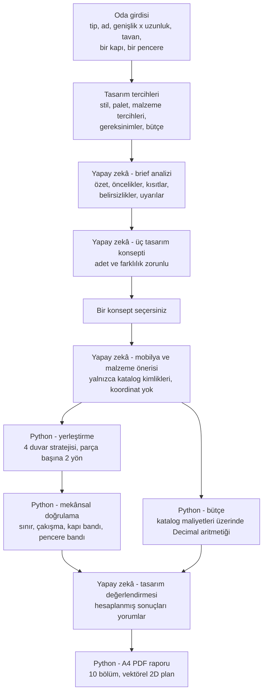
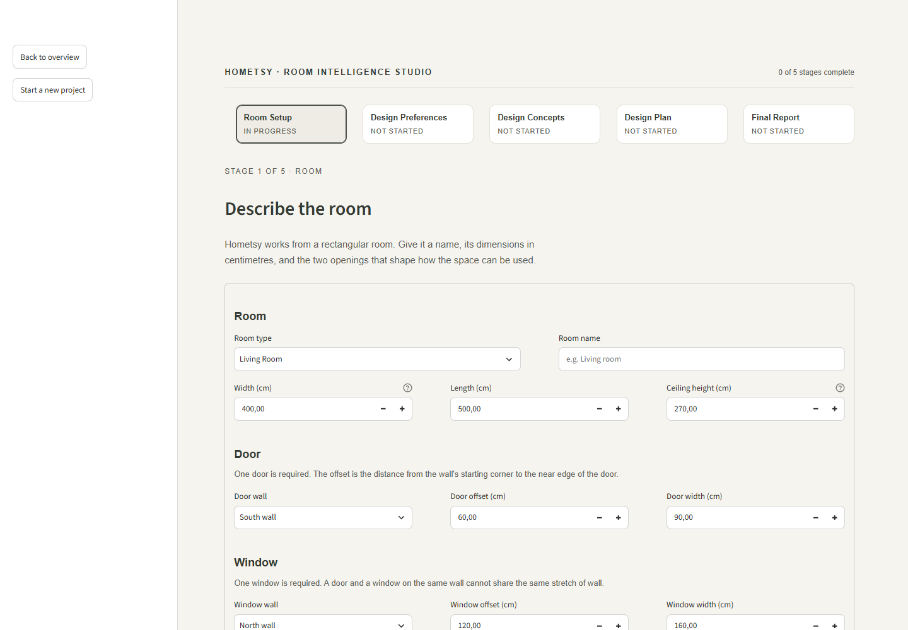
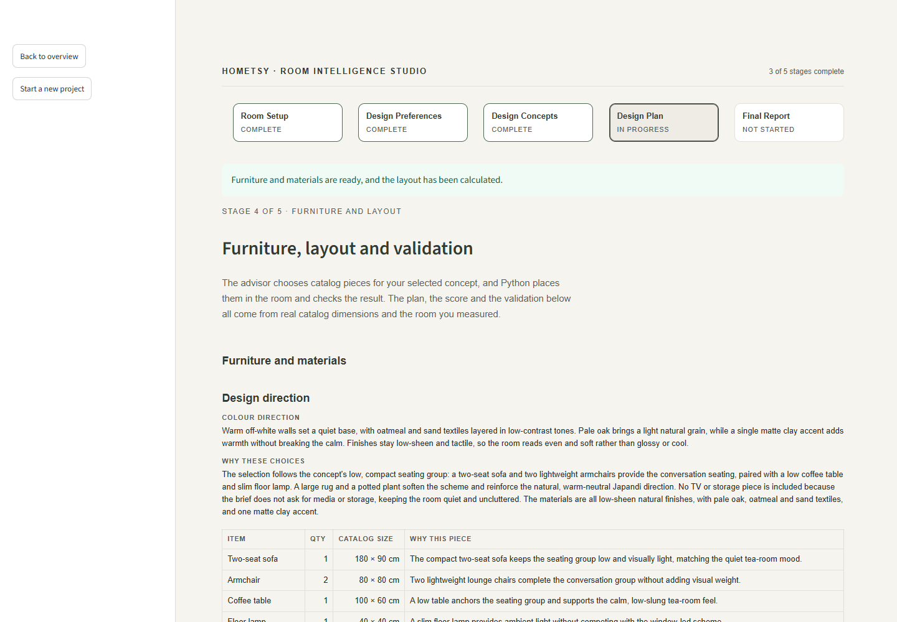
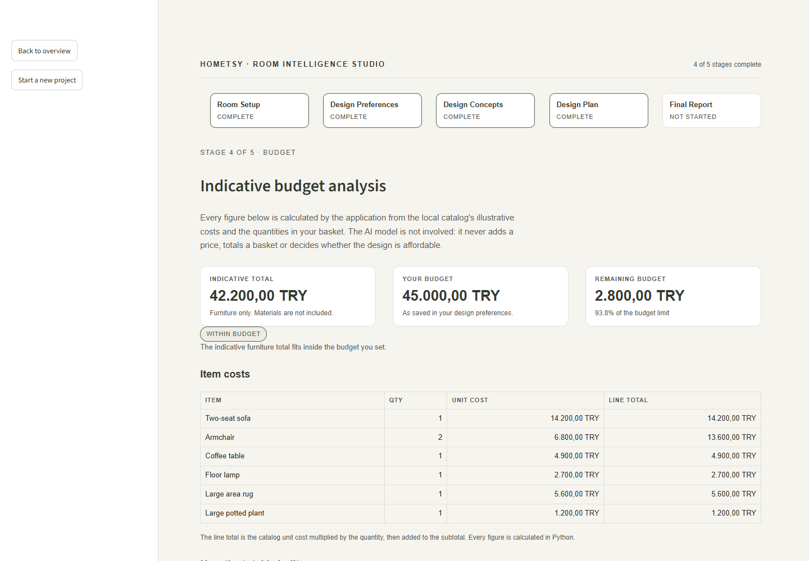

# HOMETSY — Room Intelligence Studio

**V1 · Deterministik mekânsal ve bütçe kontrolüne sahip, yapay zekâ destekli tek oda iç mekân tasarımı**

Bir odayı planlamak, birkaç soruyu aynı anda yanıtlamak demektir: mekân ne işe
yaramalı, nasıl görünmeli, hangi mobilya sığar ve bunların hepsi karşılanabilir
mi? Bu yanıtlar genellikle ayrı ayrı üretilir — burada bir mood board, orada
karalanmış bir yerleşim, bir başka yerde bir elektronik tablo — ve bu yüzden
beğendiğiniz kanepenin 220 cm genişliğinde, duvarın ise 180 cm olduğunu kimse
kontrol etmez. Genel amaçlı bir sohbet modeli bunu düzeltmez. Bir yerleşimi akıcı
biçimde anlatır ama hiçbir zaman ölçmez.

HOMETSY tek bir dikdörtgen odayı ve belirtilen bütçeyi yapılandırılmış bir tasarım
önerisine dönüştürür ve ölçülebilir olan kısmı ölçülebilir tutar. Yapay zekâ
modeli brief'i yorumlar, tasarım yönleri önerir, katalog parçaları önerir ve bir
eleştiri yazar. Python odayı ölçer, mobilyayı yerleştirir, geometriyi denetler,
sepeti fiyatlandırır ve planı çizer. Model hiçbir koordinat görmez ve hiçbir
toplam üretmez.

Ürün, bu iş bölümünü uçtan uca — testleri olan çalışan bir uygulamada, bir mimari
diyagram olarak değil — göstermek için vardır.

- Depo: <https://github.com/mertkk1623/HOMETSY-STUDIO>
- Sürüm: V1 (uygulanan tek sürüm)
- Nitelik: portfolyo projesi, tek kullanıcı, tek oda, yerel veri

---

## İçindekiler

- [A. Proje genel bakış](#a-proje-genel-bakış)
- [B. Sorun](#b-sorun)
- [C. Ürün iş akışı](#c-ürün-iş-akışı)
- [D. Temel yetenekler](#d-temel-yetenekler)
- [E. Mühendislik ve operasyonel mantık](#e-mühendislik-ve-operasyonel-mantık)
- [F. Çıktılar](#f-çıktılar)
- [G. Doğrulama ve güvenilirlik](#g-doğrulama-ve-güvenilirlik)
- [H. Mevcut kapsam ve sınırlamalar](#h-mevcut-kapsam-ve-sınırlamalar)
- [I. Yol haritası](#i-yol-haritası)
- [J. Teknik uygulama](#j-teknik-uygulama)
- [K. Uygulamayı çalıştırma](#k-uygulamayı-çalıştırma)

---

## A. Proje genel bakış

HOMETSY, bir oda tanımını — tip, ad, genişlik, uzunluk, tavan yüksekliği, bir kapı
ve bir pencere — bir tasarım stili, bir renk paleti, isteğe bağlı malzeme
tercihleri, serbest metin gereksinimler ve toplam bütçeyle birlikte alan ve bu
girdiyi sabit on adımlık bir iş akışından geçirerek indirilebilir bir PDF tasarım
raporuna ulaştıran bir Streamlit uygulamasıdır.

İş akışı sabittir ve ileri yönlüdür; kullanıcıya görünen beş aşaması vardır:

1. **Oda Kurulumu** — odayı ve iki açıklığını tanımlayın.
2. **Tasarım Tercihleri** — bir stil, bir palet, isteğe bağlı malzeme tercihleri,
   gereksinimler ve bir bütçe seçin.
3. **Tasarım Konseptleri** — yapay zekâ brief'i analiz eder, tam olarak üç
   konsept önerir ve birini seçersiniz.
4. **Tasarım Planı** — yapay zekâ katalog mobilyasını ve malzemelerini önerir,
   Python yerleşimi yapar ve doğrular, fiyatlandırır ve yapay zekâ sonucu
   değerlendirir.
5. **Nihai Rapor** — proje sonlandırılır ve A4 PDF olarak dışa aktarılır.

Uygulamayı okumaya değer kılan şey sihirbaz değil. Sistemin iki yarısı arasındaki
sözleşmedir:

| | Yapay zekâ modeli | Deterministik Python |
|---|---|---|
| Brief'i yorumlar | evet | — |
| Üç tasarım yönü önerir | evet | — |
| Katalog parçalarını kimlikle ve gerekçeyle seçer | evet | — |
| Tasarım eleştirisini yazar | evet | — |
| Koordinat atar | asla | her zaman |
| Alanı, sınırları, çakışmaları ölçer | asla | her zaman |
| Yerleşimin geçerli olup olmadığına karar verir | asla | her zaman |
| Fiyatları, ara toplamları, aşımı hesaplar | asla | her zaman |
| 2D planı ve PDF'i üretir | asla | her zaman |

Sağ sütundaki her satır, API anahtarı gerektirmeyen birim testleriyle kapsanır.
Yapay zekâ satırları, kaydedilmiş yanıtları yeniden oynatan testlerle kapsanır.

---

## B. Sorun

Bir konut odası tasarım önerisi, söylemesi kolay ve yanlış yapması da kolay beş
soruyu yanıtlamak zorundadır:

- **Sığma.** Mobilya fiziksel olarak sığıyor mu; kapı açılımı ve kapıya giden yol
  dahil?
- **Tutarlılık.** Parçalar, malzemeler ve palet üç ayrı yöne değil, tek bir yöne
  mi ait?
- **Gereksinimler.** Öneri, kullanıcının istediği şeyi gerçekten karşılıyor mu —
  depolama, çalışma alanı, misafir oturma yeri?
- **Para.** Sepet, belirtilen limite göre satır satır ne kadar tutuyor?
- **Hesap verebilirlik.** Yukarıdakilerin herhangi biri denetlenebilir mi, yoksa
  yalnızca düzyazı mı?

Zor olan son sorudur. Bir dil modelinin ürettiği metin akıcıdır, akla yatkındır ve
aritmetik olarak doğru olma yükümlülüğü yoktur. Üç kişilik bir kanepenin 180
cm'lik duvara uygun olduğunu söyleyen bir cümle, doğru olan bir cümleyle tamamen
aynı okunur. Ölçen bir katman olmadan, bir tasarım önerisi onu sipariş eden kişi
tarafından bile doğrulanamaz.

HOMETSY'nin yaklaşımı, ölçülebilir iddiaları makineyle denetlenebilir kılmak ve
modeli gerçekten yorum gerektiren kısımlarla sınırlamaktır: kısa bir brief'ten
niyeti okumak, gerçekten farklı yönler üretmek, sabit bir katalogdan seçim yapmak
ve kendi hesaplamadığı bir sonucu eleştirmek. Geometri ve aritmetik, testleri olan
sıradan ve incelenebilir Python'dur; böylece plan ile açıklama arasındaki bir
uyuşmazlık, görüş meselesi değil, yeri belli bir hatadır.

Bu, bir tasarım-planlama iş akışının gösterimidir. Bir mimarın veya iç mimarın
yerine geçmez ve profesyonel uygulama hakkında hiçbir iddia taşımaz.

---

## C. Ürün iş akışı

### Uygulamadaki yol



Öneri adımından çıkan iki ok, tasarımın asıl noktasıdır: yerleşim ve fiyat aynı
sepetten bağımsız olarak hesaplanır ve değerlendirme yalnızca ikisi de var
olduğunda çalışır. Henüz hesaplanmamış bir toplamı eleştiremez.

### Aşamalar, ekranlar ve adımlar

Arayüz beş aşama gösterir. İş akışı içeride on adım izler, yani bir aşama
bunlardan birkaçını kapsayabilir; aşama şeridi ayrı bir bayrak olarak tutulmak
yerine adım tamamlanmasından türetilir, çünkü ayrı bir bayrak zamanla
kayabilirdi.

| Aşama | Ekranlar | Ne olur | Sahibi |
|---|---|---|---|
| Oda Kurulumu | Oda bilgileri | Oda tipi, ad, ölçüler, tavan, duvar/konum/genişlik ile kapı ve pencere | Python doğrulaması |
| Tasarım Tercihleri | Tasarım tercihleri, Proje girdisi özeti | Stil, palet, isteğe bağlı malzeme tercihleri, gereksinimler, bütçe; bir özet ekranı sonraki adımların tam olarak neyi kullanacağını gösterir | Python doğrulaması |
| Tasarım Konseptleri | Tasarım brief'i, Tasarım konseptleri | Brief analizi, ardından üç konsept, ardından seçiminiz | Yapay zekâ, sonra siz |
| Tasarım Planı | Tasarım planı, Tasarım değerlendirmesi, Bütçe analizi | Öneriler, yerleştirme, doğrulama, fiyatlandırma ve eleştiri | Yapay zekâ + Python |
| Nihai Rapor | Nihai rapor | Projeyi sonlandırır ve PDF'i üretir | Python |

### Geçersiz kılma: bir değişiklik neyi siler

Yukarı akıştaki bir girdiyi düzenlemek, ona bağlı sonuçları temizler. Kurallar tek
bir tabloda (`workflow/dependencies.py`) yaşar ve başka hiçbir yerde yaşamaz; bir
ekrandaki ikinci kopya eninde sonunda ilkiyle çelişirdi.

| Değişiklik | Sildiği |
|---|---|
| Oda ölçüleri veya oda tipi | Brief, konseptler, seçim, mobilya, malzemeler, yerleşim, bütçe analizi, değerlendirme |
| Kapı veya pencere | Brief, konseptler, seçim, mobilya, malzemeler, yerleşim, değerlendirme (bütçe analizi hariç) |
| Stil, palet, malzeme tercihleri, gereksinimler | Brief, konseptler, seçim, mobilya, malzemeler, değerlendirme |
| Bütçe limiti | Brief, konseptler, mobilya, malzemeler, bütçe analizi, değerlendirme (seçim ve yerleşim hariç) |
| Seçilen konsept | Mobilya, malzemeler, yerleşim, bütçe analizi, değerlendirme |
| Önerilen mobilya | Yerleşim, bütçe analizi, değerlendirme |
| Malzemeler | Bütçe analizi, değerlendirme (yerleşim hariç) |
| Yerleşim veya bütçe analizi | Değerlendirme |

Bunlardan ikisi, eksiklik gibi göründükleri ama olmadıkları için not edilmeye
değer. Bir kapı genişliği kanepenin maliyetini değiştirmez, bu yüzden bir açıklık
düzenlemesi fiyatı olduğu gibi bırakır. Ve bir malzeme paleti V1'de geometri
taşımaz, bu yüzden onu değiştirmek doğrulanmış bir yerleşimi silmez.

---

## D. Temel yetenekler

### Oda ve gereksinim tanımı

Dört oda tipi (oturma odası, yatak odası, ev ofisi, yemek odası), her biri kendi
katalog alt kümesiyle. Kenarlar 100 cm ile 2000 cm arasında, tavan yüksekliği 200
cm ile 500 cm arasında doğrulanır ve bir açıklık en az 40 cm genişliğinde olmalı
ve tamamen kendi duvarına sığmalıdır. Tam olarak bir kapı ve bir pencere
gereklidir; ortak duvarda birbirine değebilirler ama üst üste binemezler. Her şey
santimetre olarak girilir; taban alanı metrekare olarak gösterilir.

Gereksinimler kısa maddelerden oluşan bir liste ve isteğe bağlı bir serbest metin
not alanıdır; malzeme tercihleri ise en fazla on maddelik ayrı ve isteğe bağlı bir
listedir. Bunlar katalog seçimleri değil, brief için metindir — katalog sepeti
daha sonra danışmandan gelir.

### Yapay zekâ destekli brief analizi

**Girdi:** oda gerçekleri, stil, palet, gereksinimler, bütçe.
**Çıktı:** özet, işlevsel öncelikler, kısıtlar, belirsizlikler ve uyarılar içeren
yapılandırılmış bir brief.
**Sonra:** hiçbir şey saklanmadan önce Pydantic biçimi doğrular. Bozuk bir yanıt
bir düzeltme isteği alır; hâlâ geçersizse işlem kısmi bir brief saklamak yerine
hata bildirir. Brief isteği tanımlar; odayı tasarlamaz veya mobilya seçmez.

### Tasarım konsepti üretimi

**Girdi:** analiz edilmiş brief ve tercihleriniz.
**Çıktı:** tam olarak üç konsept; her biri bir ad, açıklama, tasarım yönü, renk ve
malzeme yönü, mobilya yaklaşımı ve işlevsel gerekçeyle. Adet şemada üç olarak
sabitlenmiştir ve yinelenen konsept adları reddedilir; böylece seçim, aynı yönün
üç kopyası arasında değil, üç farklı yön arasında yapılır.

### Mobilya ve malzeme önerileri

**Girdi:** seçilen konsept, brief ve katalog.
**Çıktı:** miktarlarla birlikte katalog parça kimlikleri, parça başına bir
gerekçe, ayrıca bir gerekçe ve renk yönü olan bir malzeme paleti. Danışmana
konum, koordinat veya duvar yerleşimi atamaması açıkça söylenir. Her katalog
kimliği sonrasında yerel kataloğa ve oda tipinin desteklenen alt kümesine karşı
denetlenir; bilinmeyen veya uygunsuz bir referans bildirilir, asla sessizce
atılmaz veya sessizce kabul edilmez.

### Deterministik mobilya yerleştirme

**Girdi:** öneri sepeti, oda, açıklıklar, katalog.
**Çıktı:** yerleştirilen her kopya için gerçek koordinatlar içeren bir yerleşim,
ayrıca bir durum: tam, kısmi veya başarısız. 20 parçalık katalog gerçek ölçüleri
sağlar; döndürme, parça başına iki aday yön üreten bir ipucudur.

### Mekânsal doğrulama

**Girdi:** yerleştirilmiş ayak izleri ve oda.
**Çıktı:** bir karar ve üç liste — sınır ihlalleri, çakışmalar ve uyarılar. Karar
yalnızca mekânsal motor tarafından üretilir; yerleştirme puanı onun yerine asla
geçmez.

### Bütçe analizi

**Girdi:** sepet ve bütçe limiti.
**Çıktı:** satır bazlı bir tahmin, mobilya ara toplamı, açık bir malzeme ara
toplamı tutumu, toplam, kalan bütçe ve bir bütçe aşımı bayrağı. Tüm aritmetik
kuruş hassasiyetinde `Decimal` ile yapılır.

### Tasarım değerlendirmesi

**Girdi:** brief, seçilen konsept, önerilen parçalar ve Python'un zaten hesapladığı
mekânsal ve bütçe sonuçları.
**Çıktı:** altı düzyazı alanı — gereksinim uyumu, stil tutarlılığı, işlevsel
uygunluk, bütçe uygunluğu, sınırlamalar, öneriler. Değerlendiriciye verilen
rakamları yeniden hesaplamaması, yeniden yuvarlamaması veya onlarla çelişmemesi
söylenir.

### PDF raporlama

**Girdi:** sonlandırılmış proje.
**Çıktı:** bir kapak ve dokuz gövde bölümü (B–J harfleri) içeren bir A4 PDF —
genel bakış, brief, konsept, mobilya ve malzemeler, plan, mekânsal doğrulama,
bütçe, değerlendirme ve sınırlamalar ile yasal uyarı.

---

## E. Mühendislik ve operasyonel mantık

Bu bölüm, uygulamanın gerçekte uyguladığı kuralları belirtir. Bunlar testlerin
doğruladığı kurallardır, amaçlanan bir tasarım değil.

### 1. Oda modeli ve koordinat sistemi

Tüm iç ölçüm santimetredir. Başlangıç noktası güneybatı (sol alt) köşedir:
`genişlik` +x boyunca doğuya, `uzunluk` +y boyunca kuzeye uzanır. Açıklık konumları
aynı kuralı izler — güney ve kuzey duvarlarda batı ucundan, batı ve doğu
duvarlarda güney ucundan ölçülür.

Taban alanı `genişlik × uzunluk / 10 000`'dir ve metrekareye yalnızca sunum
sınırında çevrilir. Karşılaştırmalar 1e-6 cm'lik bir kayan nokta toleransı
kullanır, böylece paylaşılan bir kenar 1e-9'luk bir çakışma değil, paylaşılan bir
kenar olur.

Odanın kendi doğrulaması bilinçli olarak iki kez yapılır: Pydantic açıkça geçersiz
modelleri kurulum sırasında reddeder ve oda motoru değerleri kendi koşullarına
göre yeniden denetler, çünkü çağıranın geçerli bir model kurduğunu varsaymaz.

### 2. Kapı ve pencere konumlandırma

Her açıklık bir duvar, bir konum ve bir genişliktir. Her biri önünde bir açıklık
dikdörtgeni üretir:

| Açıklık | Açıklık derinliği | Bir ayak izi ihlal ederse sonuç |
|---|---|---|
| Kapı | 60 cm | Engelleme hatası — yerleşim geçersiz |
| Pencere | 30 cm | Yalnızca uyarı — yerleşim geçerli kalır |

Bu derinlikler V1'in açıklayıcı sabitleridir. Yapı kodu, erişilebilirlik veya
ergonomi gereksinimleri değildir ve kod bunu modül docstring'inde, arayüzde ve
PDF'te söyler.

Bu asimetri bilinçlidir. Engellenmiş bir kapı aralığı, odayı uygulamanın
yargılayabildiği bir biçimde kullanılamaz hale getirir. Bir pencere ise pek çok
olağan yerleşimde kısmen örtülür ve ne kadar gün ışığının kabul edilebilir olduğuna
karar vermek bu uygulamanın yapabileceği bir şey değildir; bu yüzden reddetmek
yerine bildirir.

### 3. Mobilya ölçüleri ve yerleştirme

Katalog, yedi kategoride (oturma, masalar, depolama, yatak, aydınlatma, dekor,
tekstil) 20 parça tutar; her birinin santimetre cinsinden gerçek genişliği ve
derinliği, gösterge niteliğinde birim maliyeti, uyduğu oda tipleri ve bir çizim
şekli vardır. Yerleştirme bu ölçüleri doğrudan kullanır; hiçbir şey bir resimden
tahmin edilmez.

Yerleştirme algoritması bilinçli olarak küçüktür ve tek geçişlidir:

1. Her öneriyi kimliğine göre katalogla eşleştir. Bilinmeyen bir kimlik, belirtilen
   bir gerekçeyle yerleştirilememiş parça olur — asla sessizce atılmış bir satır,
   asla bir tahmin değil.
2. Dört duvar tercihi stratejisinin her biri için — önce kuzey, önce doğu, önce
   güney, önce batı — parçaları açgözlü biçimde, en büyük ayak izinden başlayarak
   yerleştir; çünkü en büyük parçanın geçerli konumu en azdır.
3. Her parça için istenen yönü ve çeyrek turunu dene, daha iyi puan alanı tut.
   Gerçekte kullanılan yön ayak izinde saklanır, böylece plan ile tablo uyuşur.
4. Her tam aday yerleşimi puanla ve en iyisini al.

Aday konumlar sabit adımlarla üretilir — duvar parçaları için duvarlar boyunca 20
cm'lik bir bağlantı adımı, serbest parçalar için 40 cm'lik bir ızgara — sürekli
olarak optimize edilmez. Bu bilinçli bir V1 sınırıdır, bir gözden kaçırma değil:
sınırlı ve yeniden üretilebilir bir arama, bir optimize ediciden daha kolay test
edilir ve açıklanır, ve çıktısı elle yeniden türetilebilir.

Bir yerleşim altı ağırlıklı ölçütle puanlanır:

| Ölçüt | Ağırlık | Neden puanlanır |
|---|---|---|
| Sınıra sığma | 0.15 | Yasallık; bir üretim hatası puanı gizlemek yerine düşürsün diye puanda tutulur |
| Kapı erişimi | 0.20 | Kapı aralığı tek zorunlu dolaşım noktasıdır |
| Pencere açıklığı | 0.15 | Gün ışığı önemlidir, ama engelleme yalnızca uyarıdır |
| Çakışmasızlık | 0.15 | Yasallık, sınıra sığmayla aynı nedenle puanlanır |
| Dolaşım | 0.20 | Kullanılabilir serbest zemin, kapı aralığından sonraki ikinci işlevsel gereksinimdir |
| Yerleştirme kalitesi | 0.15 | Duvar bağlantısı, makul aralık, merkezî parçaların ortada olması |

Adaylar önce yerleştirilen parça sayısına, sonra puana, sonra strateji sırasına göre
sıralanır; böylece aynı girdi her zaman aynı planı üretir. Puan arayüzde geçerlilik
denetimi değil, bir kalite sezgiseli olarak tanımlanır — yüksek puan, odanın iyi
tasarlanmış olduğu anlamına gelmez.

Sonuç üç durumdan biridir ve bu ayrım rapora kadar taşınır:

- **Tam** — istenen her kopya yerleştirildi ve yerleşim geçti.
- **Kısmi** — bazı kopyalar yerleştirildi ve doğrulandı, bazıları yerleştirilemedi.
  Yerleşim sunulur, ama durum başarı değildir ve arayüz eksik parçaları adlandırır.
- **Başarısız** — hiçbir şey yerleştirilmedi veya mekânsal motor en iyi adayı
  reddetti. Yerleşim sunulmaz, böylece hiçbir çağıran reddedilmiş bir plan çizemez.

### 4. Sınır ve çakışma doğrulaması

Mekânsal motor kapalı bir soru kümesini yanıtlar ve daha fazlasını ima etmeyi
reddeder:

- Her ayak izi tamamen oda sınırının içinde mi?
- Herhangi iki ayak izi çakışıyor mu?
- Herhangi bir ayak izi kapı açıklık bandına giriyor mu?
- Herhangi bir ayak izi pencere açıklık bandına giriyor mu?
- Zeminin ne kadarı serbest kalıyor? (sezgisel bir dolaşım rakamı)

Çakışma, pozitif alanlı bir kesişim demektir. Bir kenarı paylaşan iki parça
çakışmıyor, birbirine değiyor demektir; bir depolama duvar dizisinin gerçekte
göründüğü şey budur. Sınır denetimi ile çakışma denetimi yerleştirme aramasından
bağımsızdır: seçilen yerleşim koordinatlarından yeniden doğrulanır.

Motor ergonomi, erişilebilirlik, taşıyıcı sistem veya yapı kodu hakkında hiçbir
iddia taşımaz ve ne arayüz ne de PDF aksini ima eder.

### 5. Bütçe hesaplamaları

Her şeyi tek bir modül fiyatlandırır. Katalog birim maliyetini miktarla çarpar,
satır toplamlarını toplar, toplamı limitle karşılaştırır ve fark negatifse bir aşım
bildirir.

Operasyonel olarak üç kural önemlidir:

- **Para `Decimal`'dır, asla `float` değil.** Miktarlar kuruşa (0.01) yarım yukarı
  yuvarlamayla yuvarlanır, böylece bir toplam satırla uzlaştırılabilir.
- **Fiyatlandırılamayan parça bir hatadır, sıfır değil.** Bir sepet parçası
  fiyatlandırılamıyorsa tahmin eksik olarak işaretlenir ve nihai toplam olarak
  sunulmaz. Kısmi bir sepetten hesaplanan bir toplam yanıltıcı olurdu ve
  değerlendirme prompt'una kendinden emin bir toplam verilmek yerine rakamın eksik
  olduğu söylenir.
- **Malzemeler V1'de fiyatlandırılmaz.** Malzeme fiyat listesi yoktur, bu yüzden
  malzeme ara toplamı açıkça sıfır olarak geçirilir ve *fiyatlandırılmamış* olarak
  bildirilir; girişlerin tasarımın parçası olduğu ama mobilya toplamının dışında
  kaldığı açıkça not edilir. Buradaki sıfır "maliyetlenmedi" anlamına gelir ve
  arayüz bunu sözcüklerle söyler.

Katalog maliyetleri yerel katalogla birlikte kaydedilmiş gösterge niteliğinde
rakamlardır. Doğrulanmış piyasa fiyatları, tedarikçi teklifleri veya perakendeci
verisi değildirler. V1'de yalnızca TRY onaylıdır, ancak para birimi varsayılmak
yerine veri modelinde açıktır.

### 6. Yapay zekâ değerlendirmesi ve kısıt değerlendirmesi

Değerlendirme, deterministik çıktıyı okuyan tek yapay zekâ işlemidir. Brief'i,
seçilen konsepti, önerilen parçaları, mekânsal doğrulamayı ve bütçe analizini alır
ve gereksinim uyumu, stil tutarlılığı, işlevsel uygunluk, bütçe uygunluğu,
sınırlamalar ve öneriler üzerine düzyazı döndürür.

O prompt'taki rakamlar yeniden yazılmak yerine Python nesnelerinden üretilir,
böylece prompt hesaplamadan sapamaz. Modele bunları yeniden hesaplamaması veya
yeniden yuvarlamaması söylenir ve bir yerleşim kısmi ya da bir bütçe eksikse bu
açıkça söylenir; böylece eksik bir sonucu nihai olarak tanımlayamaz.

Sizde kalan şey: önerilen yönün, odayı gerçekte nasıl yaşadığınıza uyup
uymadığıdır. Uygulama bir masanın sığdığını ve sepetin limit içinde olduğunu
denetleyebilir. Gece çalıştığınızı ve masanın pencereden uzak olması gerektiğini
bilemez.

### 7. Rapor üretimi

PDF, ReportLab tarafından A4 üzerinde, her bölüm grubu için bir sayfa ve bir
kapakla birleştirilir. Yapı sabittir:

| Bölüm | İçerik |
|---|---|
| A | Kapak: proje, oda, stil, palet, seçilen konsept |
| B | Proje genel bakış |
| C | Tasarım brief'i |
| D | Seçilen tasarım konsepti |
| E | Mobilya ve malzemeler, parça başına gerekçelerle |
| F | 2D oda planı |
| G | Mekânsal doğrulama |
| H | Bütçe analizi |
| I | Yapay zekâ tasarım değerlendirmesi |
| J | Sınırlamalar ve yasal uyarı |

F bölümünün başlığı yerleştirme durumunu izler — "Doğrulanmış 2D oda planı", "2D
oda planı (kısmi yerleşim)" veya "2D oda planı (çizilmedi)" — böylece bir başlık,
başarısız bir kararın üzerinde doğrulanmış bir plan iddia edemez.

Planın kendisi vektöreldir, motorların ürettiği aynı koordinatlardan üretilir ve
oda sınırını, açıklıkları, ayak izlerini ve bir ölçek notunu içerir. Her iki eksende
tek bir tekdüze ölçek faktörüyle çizilir; böylece odanın oranları ve her ayak
izinin oranları korunur ve çizimdeki mesafeler odadaki mesafelerle orantılıdır. Bu,
1:50 gibi ilan edilmiş bir oranı olan bir çizim ölçeğiyle aynı şey değildir: çizim
sayfaya sığdırılır, bu yüzden oran odanın boyutuna bağlıdır. Sığmayan etiketler
atlanır ve altındaki tablo tam adı, ölçüyü, döndürmeyi ve konumu taşır. Belge,
bunun açıklayıcı olduğunu, bir inşaat çizimi ve bir metraj listesi olmadığını
belirtir.

Bu, oda formundaki küçük yönlendirme krokiinden ayrıdır. O kroki
(`room_diagram_svg`) açıkça **ölçeksizdir**: her açıklığın hangi duvarda olduğunu
işaretler ve hiçbir şeyi denetlemez; erişilebilir açıklaması da dipnotu da bunu
söyler.

Dosya adı, proje adından `[a-z0-9-]` karakterlerine katlanarak türetilir ve
çözümlenen yolun çıktı dizininin içinde olduğu denetlenir, böylece uygulamaya
yazılan hiçbir şey bir dosyanın nereye düşeceğini seçemez.

---

## F. Çıktılar

Aşağıdaki tüm ekran görüntüleri, 1440 px genişlikte çalışan uygulamadan alınmış
kayıtlardır. Depo belgeleri boyunca kullanılan tek bir gösterim projesi
yapılandırmasından gelirler:

> **Oda:** Şişli Salonu, oturma odası, 400 × 500 cm (20.00 m²), 270 cm tavan,
> güney duvarında 90 cm genişliğinde kapı, kuzey duvarında 160 cm genişliğinde
> pencere.
> **Tercihler:** Japandi, Warm Neutral, 45.000 TRY bütçe.
> **Sonuç:** 6 katalog parçası, 7 kopya yerleştirildi, 42.200,00 TRY mobilya
> toplamı, tam ve geçerli yerleşim.

Ekran görüntülerindeki rakamlar o projenin rakamlarıdır. Bunlar tek bir işlenmiş
örnektir, bir kıyas ölçütü değil.

Görsellerin kendileri hakkında bir uyarı: aşağıda kullanılan dokuz ekran görüntüsü
o projenin tek bir oturumunda alınmıştır, bu yüzden rakamları birbiriyle uyuşur.
Daha geniş `docs/screenshots/` klasörü başka çalıştırmalardan da kayıtlar içerir —
örneğin 420 × 540 cm'lik ikinci bir proje — bu yüzden görseller birbirinin yerine
geçebilir parçalar olarak değil, ait oldukları kümenin parçası olarak okunmalıdır.

### Oda ve tercihler

| Oda tanımı | Tasarım tercihleri |
|---|---|
|  |  |

Oda formu ölçüleri santimetre olarak alır ve kapı ile pencerenin duvarını, konumunu
ve genişliğini sorar. Tercihler ekranı yerel stil ve palet kütüphanesini gösterir;
bu görseller referans malzemedir, yapay zekâya gönderilmez ve ekran bunu söyler.

### Konseptler


Brief'ten yazılmış, seçilen stili ve paleti paylaşan ama odayı farklı biçimde
düzenleyen üç konsept. Stil referans görseli, konseptin tasviri olarak değil,
referans olarak açıklanır.

### Öneriler ve yerleştirme

| Mobilya ve malzemeler | Ölçülendirilmiş 2D plan |
|---|---|
|  |  |

Öneri tablosu her parçanın katalog ölçüsünü ve seçilme gerekçesini verir. Plan
yerleştirilmiş koordinatlardan çizilir, bu yüzden 90° döndürülmüş 180 × 90 cm'lik
bir kanepe çizimde ve altındaki tabloda 90 × 180 cm olarak görünür.

### Doğrulama, değerlendirme ve bütçe

| Mekânsal doğrulama | Tasarım değerlendirmesi |
|---|---|
|  |  |

Doğrulama ekranı yerleştirilen ölçüleri, döndürmeleri ve konumları, motorun
kararını ve puanın ölçüt bazında ağırlık ve katkıyla dökümünü gösterir; böylece
rakam güvenilmek yerine denetlenebilir.



Bütçe ekranı mobilya toplamını malzeme girdilerinden ayırır; malzemeler sıfır
olarak sayılmak yerine *fiyatlandırılmamış* olarak listelenir. Maliyet dağılımı
aynı satır öğelerinden çizilir.

### Rapor


Rapor ekranı PDF'in neyi içereceğini özetler ve indirmeyi sunar. Proje değişene
kadar kullanılabilir kalır; bir değişiklik, bayat bir belgenin indirilmesine izin
vermek yerine raporu siler.

Depoya eklenmiş bir örnek rapor
`reports/phase-6/sample/hometsy-sisli-salonu-report.pdf` adresinde bulunur — 11
sayfa: kapak (A bölümü) artı dokuz gövde bölümü, B–J. Bölümler sayfalarla bire bir
eşleşmez; örneğin plan bölümü bir sayfayı çizim, sonraki sayfayı yerleştirilen
parçalar tablosu için kullanır. `generate_report()` tarafından yapay zekâ çağrısı
ve ağ erişimi olmadan deterministik olarak üretilir; ikinci bir test projesinden
(400 × 520 cm, Industrial, on yerleştirilmiş parça, 58.600,00 TRY mobilya ara
toplamı) geldiği için rakamları yukarıdaki ekran görüntülerinden farklıdır. O
dosyanın sayfa sayfa yazılı doğrulaması `reports/phase-6/PDF_SAMPLE_NOTES.md`
içindedir.

---

## G. Doğrulama ve güvenilirlik

Aşağıdaki kanıtlar projenin `reports/` altındaki kendi raporlarında kayıtlıdır. Bu
uygulamaya dair mühendislik kanıtıdır, ticari performans kanıtı değildir.

### İşlevsel iş akışı doğrulaması

Dokuz ekran, Streamlit'in kendi `AppTest` düzeneği üzerinden uçtan uca sürülür;
böylece testler uygulamanın yeniden yazımını değil, gerçek uygulama nesnesini
çalıştırır. Hem eylem öncesi hem eylem sonrası durumların ekran ekran kayıtları
`docs/screenshots/` altında tutulur.

### Geometrik ve iş kuralı doğrulaması

Yerleştirme, mekânsal doğrulama ve bütçe aritmetiğinin her biri, E bölümünde
anlatılan kuralları doğrulayan ayrı test modüllerine sahiptir: sınıra sığma,
kenara değme ile çakışma ayrımı, kapı ve pencere bantları, yön işleme, kısmi ve
başarısız sonuçlar, `Decimal` yuvarlaması ve fiyatlandırılamayan parça yolu.
Geliştirme sırasında düzeltilen bir kusur, düzeltme geri alınıp testlerin
başarısız olduğu doğrulanarak denetlendi — aşağıda anlatılan başlık düzeltmesi bu
şekilde kontrol edildi.

### Otomatik yazılım testi

Kayıtlı V1 temel çizgisi:

```
1.149 geçti, 0 başarısız, 0 atlandı
```

İki kayıt düşülmelidir. Birincisi, paket canlı bir API anahtarı gerektirmez ve
hiçbir ağ çağrısı yapmaz; yapay zekâ katmanı testleri kurgulanmış ve kaydedilmiş
yanıtları yeniden oynatır. İkincisi, bu rakam bu belge için **yeniden
çalıştırılmadı** — yayın raporlarındaki kayıtlı sonuçtur ve toplama sayısının
1.149 test olduğu doğrulanmıştır. Geçen bir paket, doğrulanan kuralların geçerli
olduğuna dair kanıttır, doğruluk garantisi değildir ve büyüklüğü bir kalite puanı
değildir.

### Duyarlı arayüz doğrulaması

Gerçek bir tarayıcıda 1440, 1024, 768, 430, 404, 390 ve 360 px genişlikte
ölçüldüğünde sayfa hiçbir zaman yatay kaymaz. Dar ekranlarda plan tam ölçeğini
korur ve etiketleri okunabilirliğin altına küçültmek yerine kendi odaklanabilir
çerçevesi içinde yana kaydırılır.

### Erişilebilirlik denetimleri

- **Otomatik:** axe-core 4.10.2, dokuz ekranda sıfır ihlal bildirir.
- **Kayıt:** axe'in başlık kuralı (`page-has-heading-one`) bu sürümde hiç `h1`'i
  olmayan bir sayfayı geçirdi, bu yüzden sıfır ihlal sonucu başlık yapısı
  hakkında hiçbir zaman kanıt olmadı. Başlık yapısı artık dokuz ekranın hepsini
  süren testlerle doğrudan doğrulanıyor: ekran başına bir `h1`, atlanmış seviye
  yok, gerçek `h2`/`h3` bölüm başlıkları, boş başlık yok.
- **Yapılmayan:** hiçbir ekran okuyucu dinleme oturumu yapılmadı. NVDA'nın
  bulunmadığı doğrulandı ve yayın incelemesi için bilinçli olarak kurulmadı. Bir
  ekran okuyucunun tükettiği erişilebilirlik ağacı doğrudan incelendi ve bu
  inceleme, düzeltilen başlık kusurunu buldu. Bu yapısal kanıttır, bir ekran
  okuyucuyu dinlemenin yerine geçmez.

Proje, ekran okuyucu uyumluluğu veya WCAG uygunluğu iddia etmez. Bkz.
`reports/portfolio-release/RELEASE_READINESS.md` ve
`reports/portfolio-release/SCREEN_READER_TEST.md`.

---

## H. Mevcut kapsam ve sınırlamalar

V1 bilinçli olarak sınırlıdır. Aşağıdaki sınırlar tamamlanmamış işler değil, tasarım
kararlarıdır ve her biri keşfedilmeye bırakılmak yerine arayüzde veya raporda
belirtilir.

**V1'in destekledikleri**

- Tek dikdörtgen konut odası, dört oda tipi, bir kapı ve bir pencere.
- Yerel referans görselleriyle altı tasarım stili ve dört palet yönü.
- Gerçek ölçülere ve gösterge maliyetlere sahip 20 parçalık yerel katalog.
- Proje başına üç yapay zekâ konsepti, biri seçilir.
- Deterministik yerleştirme, doğrulama, fiyatlandırma ve PDF dışa aktarımı.

**V1'in yapmadıkları**

| Desteklenmeyen | Neden önemli |
|---|---|
| Düzensiz geometri — L şekilleri, girintiler, kolonlar, eğimli tavanlar | Geometri motoru eksen hizalı dikdörtgenler üzerinde çalışır |
| Fotoğrafa dayalı ölçüm veya görsel analiz | Model yalnızca metindir; referans görseller ona hiç gönderilmez |
| Yapay zekâ ile üretilmiş iç mekân görselleri | Hiçbir görsel üretimi entegre değildir |
| 3D görselleştirme | Plan tasarım gereği 2D'dir |
| Elle sürükle-bırak düzenleme | Yerleşim üretilir; yeniden hesaplayabilirsiniz ama bir parçayı elle taşıyamazsınız |
| Çok odalı projeler | Bir proje, bir oda |
| Hesaplar, kaydedilmiş projeler, veritabanı kalıcılığı | Yalnızca oturum durumu; oturum bittiğinde iş akışı sıfırlanır |
| Canlı fiyatlandırma, perakendeci entegrasyonu, ödemeler | Katalog maliyetleri gösterge niteliğinde rakamlardır |
| Malzeme maliyetlendirmesi | V1'de malzeme fiyat listesi yoktur |

İki sınırlama, listelemek yerine açıkça söylenmeyi hak ediyor:

- **Plan açıklayıcıdır.** Gerçek koordinatlardan tek bir tekdüze ölçek faktörüyle
  çizilir, bu yüzden oranları dürüsttür — ama oran ilan edilmek yerine sayfaya
  sığdırılır ve bir inşaat çizimi, bir metraj listesi veya bir uygunluk belgesi
  değildir.
- **Doğrulama temeldir.** Sınıra sığma, çakışma, kapı yaklaşımı, pencere bandı ve
  açıkça etiketlenmiş bir dolaşım sezgiseli. Bu bir ergonomi, erişilebilirlik,
  taşıyıcı sistem veya yapı kodu değerlendirmesi değildir.

---

## I. Yol haritası

Yalnızca V1 uygulanmıştır. V2 ve V3 planlanmıştır ve uygulamada, katalogda veya API
yüzeyinde bulunmaz.

### V1 — Temel Oda Zekâsı İş Akışı *(uygulandı)*

Dikdörtgen oda kurulumu ve tasarım tercihleri; yapay zekâ brief analizi ve üç
tasarım konsepti; yerel katalogdan mobilya ve malzeme önerileri; mekânsal
denetimlerle ölçülendirilmiş 2D oda planı; deterministik bütçe analizi; yapay zekâ
tasarım değerlendirmesi; PDF raporu.

### V2 — Görsel Anlama *(planlandı)*

Oda fotoğrafı analizi, görsele dayalı stil çıkarımı, yapay zekâ ile üretilmiş
konsept görselleri, ek yerleşim alternatifleri. Bunlar, V1'in sahip olmadığı görsel
yeteneği olan bir model ve bir görsel işleme hattı gerektirir.

### V3 — İleri Mekânsal Planlama *(planlandı)*

3D görselleştirme, çok odalı planlama, ürün kataloğu entegrasyonu, ileri mekânsal
optimizasyon.

Kaynak: `PROJECT_BRIEF.md` §12, uygulamanın kendi yol haritası panelinde de
yansıtılır; böylece arayüz, uygulamanın sunduğundan fazlasını ilan edemez.

---

## J. Teknik uygulama

| Katman | Sorumluluk |
|---|---|
| Arayüz (`ui/`) | Dokuz ekran, beş aşamalı kabuk, tema, SVG plan çizimi |
| İş akışı (`workflow/`) | Oturum durumu, adım önkoşulları, geçersiz kılma tablosu |
| Yapay zekâ (`ai/`) | Tek istemci, dört işlem, şema öncelikli prompt'lar ve ayrıştırma |
| Modeller (`models/`) | Pydantic şemaları ve dayattıkları kısıtlar |
| Motorlar (`core/`) | Oda geometrisi, yerleştirme, mekânsal doğrulama, bütçe, PDF |
| Veri (`data/`) | Mobilya kataloğu, stil ve palet kütüphanesi üst verisi |

Yığın: Python 3.13, Streamlit 1.67, Pydantic 2.11+, Matplotlib 3.11+ (maliyet
dağılımı grafiği), ReportLab 4.4+ (PDF), pytest 9.0+ (testler).

**Yapay zekâ entegrasyonu.** Model `deepseek-ai/deepseek-v4.1-flash-1017`'dir ve
`ai/config.py` içinde yapılandırılmış OpenAI uyumlu bir uç nokta üzerinden
çağrılır. Kimlik bilgisi `DEPLOY_API_KEY` ortam değişkeninden veya Streamlit'in
gizli değer deposundan okunur ve `repr`'den ve her hata mesajından çıkarılmıştır.
Kullanıcı eylemi başına tek çağrı vardır ve zaman aşımı 60 saniyedir.

Hata işleme, körlemesine yeniden denemek yerine iki durumu ayırır. Bir taşıma
hatası — zaman aşımı, kimlik doğrulama, hız limiti, kesilme — sınıflandırılır ve
yüzeye çıkarılır; yeniden denenmez, çünkü tekrarlamak aynı hatayı tekrarlamak
olurdu. Gelen ama ayrıştırılamayan veya şemaya uymayan bir yanıt tam olarak bir
düzeltme isteği alır ve o da başarısız olursa hata bildirilir. Sağlayıcı hata
gövdeleri yüzeye çıkarılmadan önce temizlenir ve hiçbir başarısızlık başarılı bir
sonuç olarak saklanmaz.

**Katmanlar arası sınırlar.** Uygulama giriş noktası yapay zekâ paketini hiç içe
aktarmaz: yapay zekâ destekli ekranlar onu bir düğmeye basıldığında tembel olarak
içe aktarır, böylece modeli hiç çağırmayan bir oturum onu hiç yüklemez. Arayüz
katmanında hiçbir geometri, bütçe veya PDF mantığı yaşamaz. `ui/diagram.py`,
kendisine verilen koordinatlardan SVG çizer; onları hesaplamaz.

**Veri.** `data/furniture_catalog.json` 20 katalog parçasını tutar.
`data/design_references.json` altı stili ve dört paleti yerel görsellerle ve modele
gönderilen metin açıklamalarıyla eşler. Referans görseller bu proje için
üretilmiştir ve hiçbir üçüncü taraf stok fotoğraf kullanılmaz; manifest kaynak
bilgisini ve platform koşulları incelemesini kaydeder. Yapay zekâ kategori
kimliklerini ve metni alır, görsel dosyalarını hiç almaz.

---

## K. Uygulamayı çalıştırma

### Gereksinimler

- Python 3.13 (bu projenin geliştirildiği ve test edildiği sürüm; hiçbir
  `python_requires` kısıtı ilan edilmemiştir, bu yüzden daha yeni bir yorumlayıcı
  muhtemelen çalışır ama doğrulanmamıştır)
- Yapay zekâ özellikleri için bir API kimlik bilgisi (deterministik özellikler
  onsuz da çalışır)

### Kurulum

```bash
python -m venv .venv

# Windows
.venv\Scripts\activate
# macOS / Linux
source .venv/bin/activate

pip install -r requirements.txt
```

### Kimlik bilgisini yapılandırma

```bash
# Windows (PowerShell, geçerli oturum)
$env:DEPLOY_API_KEY = "anahtar-buraya"

# macOS / Linux
export DEPLOY_API_KEY="anahtar-buraya"
```

Alternatif olarak `.streamlit/secrets.toml` oluşturun:

```toml
DEPLOY_API_KEY = "anahtar-buraya"
```

`.env` ve `.streamlit/secrets.toml` sürüm kontrolünden hariç tutulur. Bir anahtarı
asla commit etmeyin.

**Kimlik bilgisi olmadan da uygulama çalışır.** Oda kurulumu, tercihler, özet,
bütçe aritmetiği ve PDF'in deterministik bölümleri çalışır. Yapay zekâ düğmeleri
sessizce başarısız olmak yerine servisin yapılandırılmadığını bildirir ve test
paketi hiçbir zaman anahtar gerektirmez.

### Çalıştırma

```bash
streamlit run app.py
```

Streamlit'in yazdırdığı adresi açın (varsayılan `http://localhost:8501`). Farklı bir
port için:

```bash
streamlit run app.py --server.port 8512
```

Üretilen raporlar `output/reports/` altına yazılır; bu dizin, dosyalar proje
verisinden yeniden üretilebildiği için sürüm kontrolünden hariç tutulur.

### Test

```bash
.venv\Scripts\python.exe -X utf8 -m pytest -q
```

Paket şemaları, dört deterministik motorun tamamını, taklit yanıtlarla yapay zekâ
katmanını, iş akışı geçersiz kılmasını, `AppTest` üzerinden her ekranı ve üretilen
PDF'i kapsar.

---

## Dokümantasyon

| Belge | İçerik |
|---|---|
| `PROJECT_BRIEF.md` | Ürün kapsamı, gereksinimler, yol haritası |
| `TECHNICAL_ARCHITECTURE.md` | Katman sözleşmeleri ve veri akışı |
| `DESIGN_SYSTEM.md` | Görsel yön, palet, tipografi, bileşenler |
| `DEVELOPMENT_PLAN.md` | Aşamalı geliştirme planı |
| `AGENTS.md` | Mühendislik ve kalite kuralları |
| `COPYRIGHT.md` | Tescilli haklar ve üçüncü taraf atıfları |
| `docs/PORTFOLIO_CASE_STUDY.md` | Sorun, mimari, mühendislik kararları, kalite kanıtı |
| `reports/` | Aşama bazlı tamamlanma, test ve hazırlık raporları |

---

HOMETSY — Room Intelligence Studio. V1, portfolyo projesi, ticari bir hizmet
değil. İlginç olan kısım bir modelin iç mekân tasarımı hakkında yazabilmesi
değil; modelin nerede durduğu ve mühendisliğin nerede başladığıdır.
