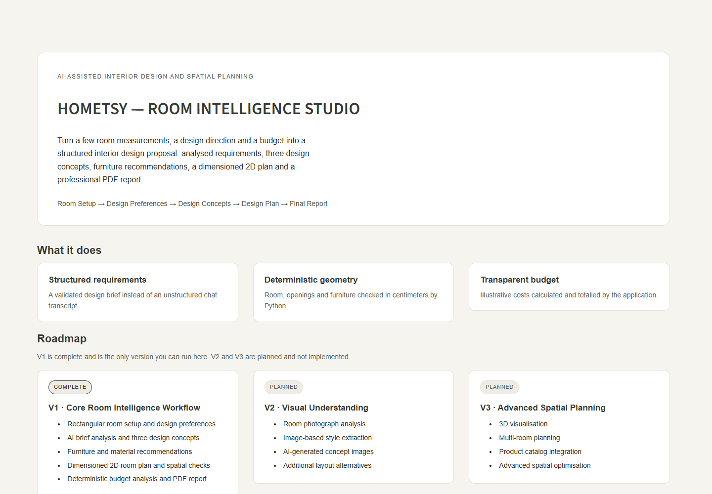
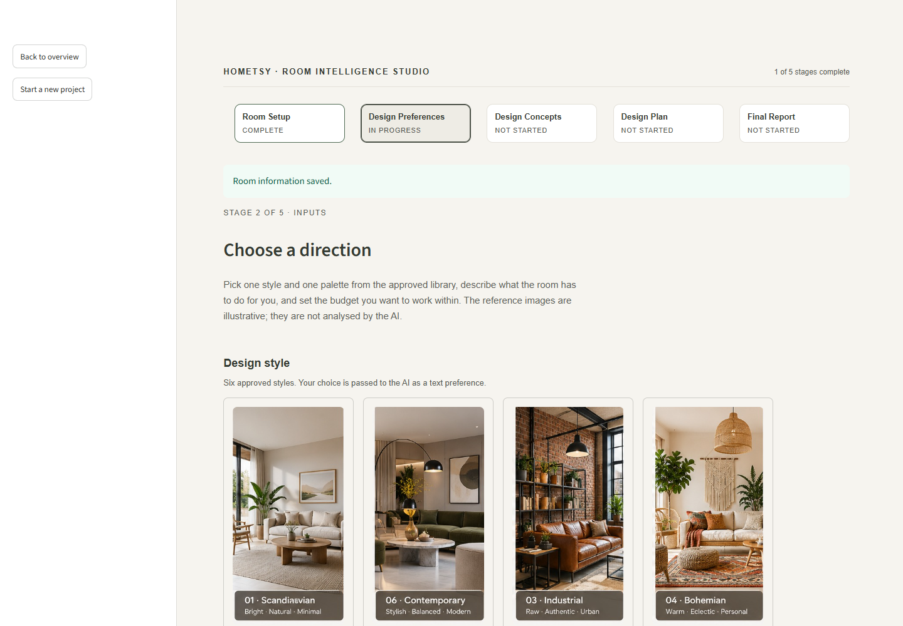
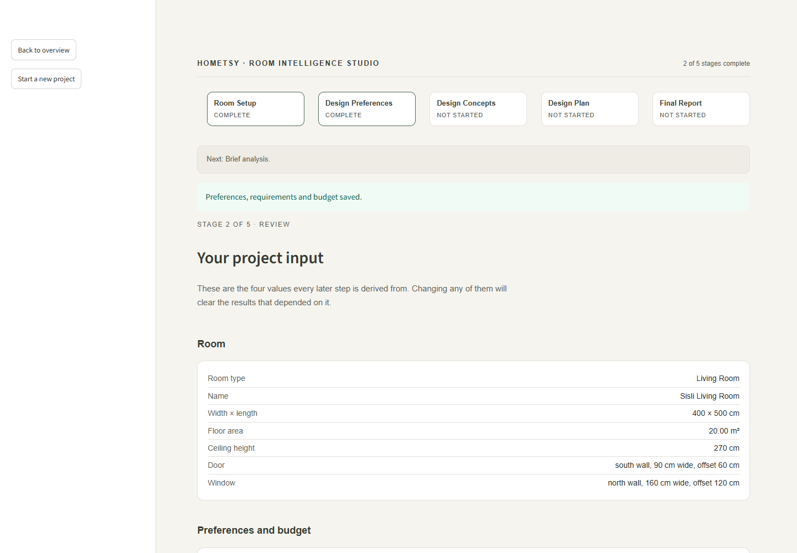
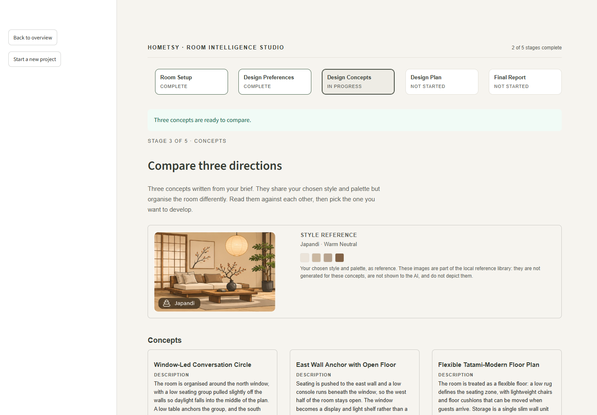
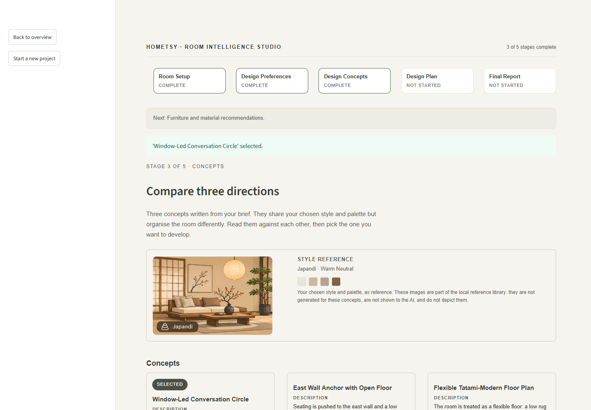
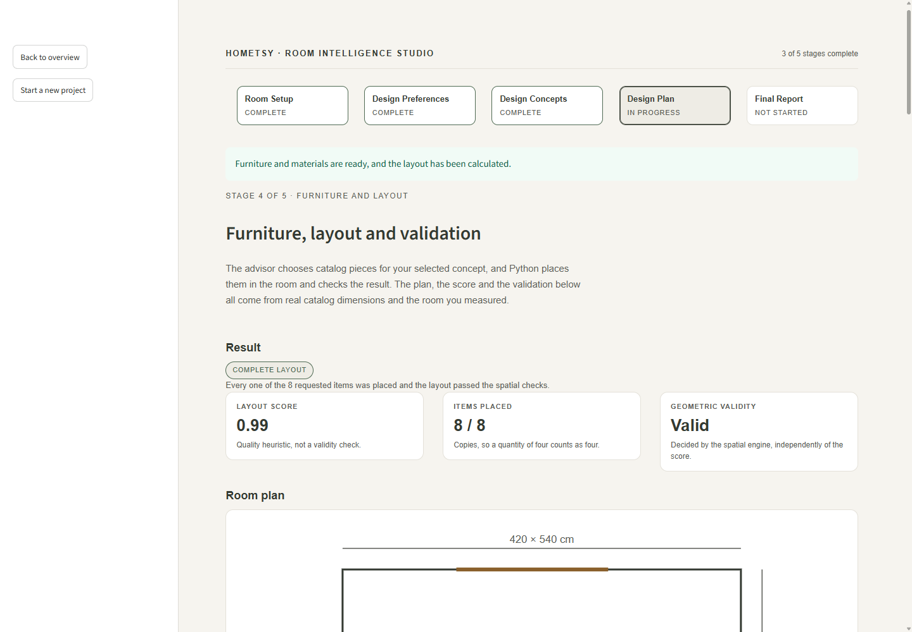
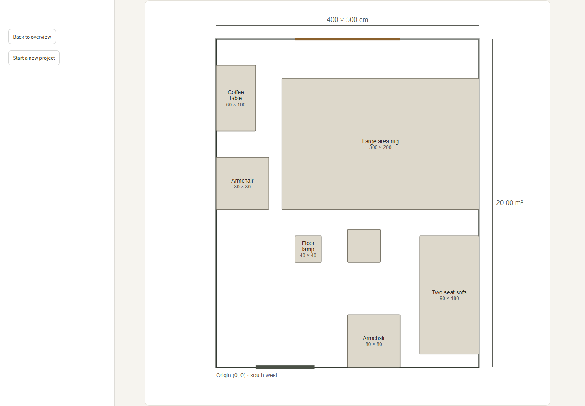
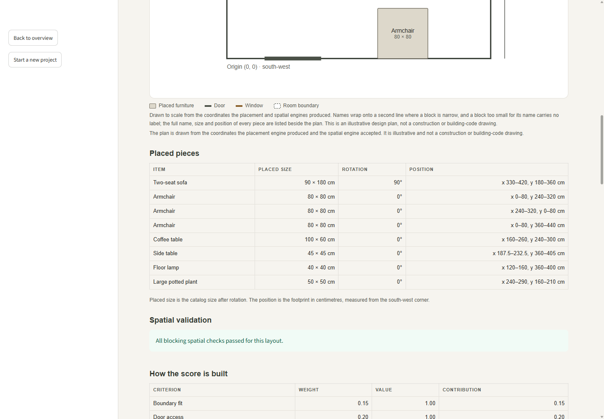
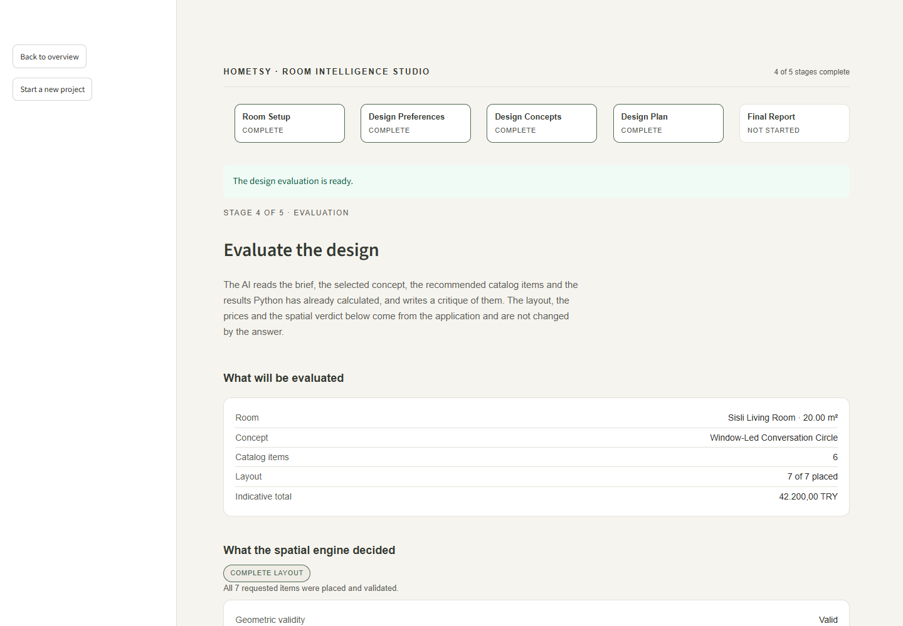
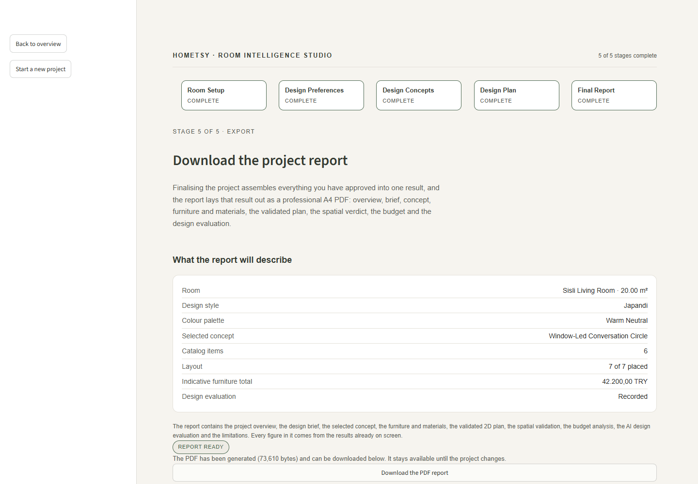

# HOMETSY — Room Intelligence Studio

Tek bir dikdörtgen oda için yapay zekâ destekli iç mekân tasarımı ve mekânsal
planlama uygulaması. Odayı, tasarım yönünü ve bütçeyi girersiniz; uygulama
brief'i analiz eder, üç tasarım konsepti önerir, yerel katalogdan mobilya
önerir, gerçek ölçülerle ölçekli bir 2D plan çizer, geometrik doğrulamayı
deterministik olarak yapar, sonucu fiyatlandırır ve profesyonel bir PDF raporu
üretir.

Bu proje ticari bir ürün değil, bir portfolyo çalışmasıdır. Amacı, dil modeli
muhakemesi ile deterministik mühendislik arasındaki temiz ayrımı göstermektir:
model yorumlar ve yazar, Python ölçer ve hesaplar.

---

## İçindekiler

- [Ne yapar](#ne-yapar)
- [Ekran görüntüleri](#ekran-görüntüleri)
- [Mimari](#mimari)
- [Yapay zekâ / Python ayrımı](#yapay-zekâ--python-ayrımı)
- [Teknoloji yığını](#teknoloji-yığını)
- [Kurulum](#kurulum)
- [Yapılandırma](#yapılandırma)
- [Uygulamayı çalıştırma](#uygulamayı-çalıştırma)
- [İş akışı](#iş-akışı)
- [Testler](#testler)
- [Veri ve görseller](#veri-ve-görseller)
- [Bilinen sınırlamalar](#bilinen-sınırlamalar)
- [Yol haritası](#yol-haritası)
- [Dokümantasyon](#dokümantasyon)

---

## Ne yapar

V1 yolculuğu, uygulama kabuğunda her ekranda görünen beş aşamadan oluşur:

| Aşama | Ne olur |
|---|---|
| **1 · Oda Kurulumu** | Santimetre cinsinden dikdörtgen oda ölçüleri, duvar ve konum bilgisiyle bir kapı ve bir pencere. Kaydedilmeden önce doğrulanır. |
| **2 · Tasarım Tercihleri** | Altı tasarım stilinden biri, dört palet yönünden biri, serbest metin gereksinimler, isteğe bağlı malzemeler ve bütçe limiti. |
| **3 · Tasarım Konseptleri** | Yapay zekâ brief'i yapılandırılmış bir özete dönüştürür, ardından üç farklı konsept yazar. Birini seçersiniz. |
| **4 · Tasarım Planı** | Yapay zekâ katalog parçalarını önerir; Python bunları yerleştirir, sınırları ve çakışmaları denetler, yerleşimi puanlar, sepeti fiyatlandırır ve tasarımı değerlendirir. |
| **5 · Nihai Rapor** | Genel bakış, brief, konsept, mobilya ve malzemeler, doğrulanmış plan, mekânsal karar, bütçe, yapay zekâ değerlendirmesi ve sınırlamaları içeren A4 PDF. |

Somut olarak:

- **Oda girdisi doğrulanır, güvenilmez.** Ölçüler aralık denetiminden geçer,
  kapı ve pencere duvarının içinde olmak zorundadır ve pencere odanın alanını
  kullanılamaz bırakmamalıdır.
- **Mobilya gerçektir.** Her öneri yerel katalogla karşılaştırılır; katalogda
  olmayan bir parça çizilmek yerine reddedilir.
- **Plan gerçek ölçülerden çizilir.** 220 × 90 cm'lik bir kanepe 220 × 90 cm
  olarak, döndürme dahil yerleştirilir ve çizimdeki blok o ayak izidir.
- **Yerleşim deterministiktir.** Sınır ve çakışma denetimleri, kapı erişimi,
  pencere açıklığı ve dolaşım, yerleştirilmiş ayak izlerinden Python'da
  hesaplanır. Mobilyanın sığıp sığmadığına model karar vermez.
- **Bütçe aritmetiktir.** Birim maliyetler katalogdan gelir, miktarla çarpılır;
  toplam, kalan bütçe ve aşım Python'da `Decimal` aritmetiğiyle hesaplanır.
- **Fiyatı olmayan parça sıfır olarak maliyetlenmez.** V1'de malzemelerin fiyat
  listesi yoktur; bu yüzden *fiyatlandırılmamış* olarak listelenir ve mobilya
  toplamının dışında tutulur.
- **Kısmi veya başarısız yerleşim olduğu gibi sunulur.** Yalnızca bazı parçalar
  sığarsa plan kısmi olarak etiketlenir ve yerleşmeyen parçalar odada
  olmadıkları belirtilerek adlandırılır. Yerleştirme motoru adayı reddederse
  plan çizilmez — ekran, reddedilen mobilyayı göstermez.
- **Başarısız bir yapay zekâ çağrısı sonuç olmaz.** Kesilmiş, bozuk veya şemaya
  uymayan model çıktısı ekranda hata olarak görünür, uydurma bir başarı olarak
  değil.

### Desteklenen oda tipleri

Oturma Odası, Yatak Odası, Ev Ofisi, Yemek Odası.

### Tasarım stilleri ve paletler

Altı stil: Scandinavian, Contemporary, Industrial, Bohemian, Warm Minimalism,
Japandi. Dört palet yönü: Warm Neutral, Earthy, Cool Modern, Natural Materials.

Her iki kütüphane de yereldir. Her stilin ve paletin bir referans görseli ve bir
metin açıklaması vardır; modele ulaşan şey açıklamadır.

---

## Ekran görüntüleri

Tüm ekran görüntüleri çalışan uygulamadan alınmıştır. Mockup değildir.

| | |
|---|---|
|  |  |
| **Açılış** — beş aşamalı yolculuk ve dürüst bir yol haritası | **Oda kurulumu** — doğrulanan santimetre girdisi |
|  |  |
| **Tasarım tercihleri** — altı stil, dört palet, bütçe | **Proje özeti** — yapay zekânın alacağı her şey |
|  |  |
| **Tasarım konseptleri** — karşılaştırılacak üç yön | **Seçilen konsept** — geliştirilecek yön |
|  |  |
| **Tasarım planı** — mobilya, yerleşim ve doğrulama | **Plan çizimi** — ölçekli ve ölçülendirilmiş |
|  |  |
| **Mekânsal doğrulama** — motorun kararı | **Tasarım değerlendirmesi** — yapay zekâ eleştirisi |
|  |  |
| **Bütçe analizi** — deterministik aritmetik | **Nihai rapor** — PDF indirilmeye hazır |

Mobil yerleşimler de dahildir:
[390 px'te plan](docs/screenshots/19-plan-mobile-390.png) ve
[390 px'te bütçe](docs/screenshots/20-budget-mobile-390.png).

On görselli sunum seçkisi
[`docs/screenshots/portfolio/`](docs/screenshots/portfolio/) altında anlatı
sırasına göre durur; gerekçesi
[`reports/portfolio-release/SCREENSHOT_SELECTION.md`](reports/portfolio-release/SCREENSHOT_SELECTION.md)
içinde açıklanmıştır.

---

## Mimari

Tek bir Streamlit süreci. Katmanlar aşağıya doğru bağımlıdır; `core`, `ai`,
`models` ve `workflow` içinde hiçbir şey Streamlit'i içe aktarmaz.

```
app.py                      Streamlit giriş noktası, ekran yönlendirmesi
│
├── ui/                     Sunum ve Streamlit adaptasyonu
│   ├── shell.py            marka çubuğu, aşama şeridi, aşama sözlüğü
│   ├── theme.py            tek stil sayfası ve renk belirteçleri
│   ├── session.py          tarayıcı oturumu başına bir WorkflowState
│   ├── pages_*.py          her ekran için bir modül
│   ├── diagram.py          oda ve plan SVG'leri
│   ├── ai_actions.py       yapay zekâ servislerinin çağrıldığı tek yer
│   └── commits.py          doğrula → sakla → alt adımları geçersiz kıl
│
├── workflow/               Durum makinesi (Streamlit yok)
│   ├── state.py            WorkflowState, tamamlanma, geçersiz kılma
│   └── dependencies.py     her adımın neye bağlı olduğu
│
├── core/                   Deterministik motorlar (Streamlit yok, yapay zekâ yok)
│   ├── room_engine.py      oda geometrisi ve açıklıklar
│   ├── placement_engine.py mobilya yerleştirme
│   ├── spatial_engine.py   sınır, çakışma, erişim, dolaşım
│   ├── budget_engine.py    katalog üzerinde Decimal aritmetiği
│   ├── validation.py       ortak doğrulama yardımcıları
│   └── report_generator.py A4 PDF (ReportLab)
│
├── ai/                     Model erişimi (Streamlit yok)
│   ├── config.py           uç nokta, model, kimlik çözümleme
│   ├── client.py           HTTP taşıma, tipli hatalar
│   ├── prompt.py           prompt kurulumu ve şema dayatması
│   ├── parsing.py          yapılandırılmış çıktı ayrıştırma ve onarım
│   ├── brief_analyzer.py   işlem 1
│   ├── concept_generator.py işlem 2
│   ├── design_advisor.py   işlem 3
│   └── design_evaluator.py işlem 4
│
├── models/schemas.py       Her katmanın paylaştığı Pydantic modelleri
├── data/                   katalog ve referans kütüphanesi (JSON)
└── tests/                  1.149 test
```

### Katmanlar neden ayrı

`workflow`, *kullanıcının ne yaptığının* tek doğruluk kaynağıdır. Adım
tamamlanması bayrak olarak saklanmaz; **verinin varlığından ve önkoşullarından
türetilir**. Bu yüzden bütçeyi düzenlemek geride bayat bir "tamamlandı" bayrağı
bırakamaz: bağımlı sonuçlar temizlenir ve türetilen durum bunu yansıtır.

`core` hiçbir zaman yapay zekâ çağırmaz, `ai` hiçbir zaman geometri, para veya
çizim yapmaz. Streamlit'in varlığını bilen tek katman `ui`'dir.

### Geçersiz kılma

Yukarı akıştaki bir girdiyi değiştirmek, ona bağlı olan alt akış işlerini
temizler. Bütçe limitini değiştirin, saklanan bütçe analizi silinir; konsept
seçimini değiştirin, plan, değerlendirme ve bütçe de gider. Saklanan bir sonuç
asla güncelmiş gibi gösterilmez.

---

## Yapay zekâ / Python ayrımı

Bu, projenin merkezî tasarım kararıdır.

**Model yalnızca dört şey için kullanılır:**

| İşlem | Modelin ürettiği | Python'un sonra yaptığı |
|---|---|---|
| Brief analizi | Yapılandırılmış özet: hedefler, kısıtlar, fırsatlar, açık sorular | Şemayı doğrular ve saklar |
| Konsept üretimi | Üç konsept: ad, gerekçe, mekânsal strateji, palet, ana parçalar | Adet, farklılık ve katalog makullüğünü doğrular |
| Mobilya önerisi | Katalog parça kimlikleri, miktarlar, parça başına gerekçe, malzemeler | Her kimliği katalogla denetler, yerleştirir, geometriyi doğrular |
| Tasarım değerlendirmesi | Eleştiri: güçlü yönler, riskler, öneriler | Kendi hesapladığı yerleşimi, puanı ve fiyatları korur |

**Her sayı Python'a aittir.** Oda alanı, duvar uzunlukları, açıklık konumları,
mobilya ayak izleri, döndürme, sınır ve çakışma denetimleri, açıklıklar, yerleşim
puanı, birim maliyetler, ara toplamlar, toplam, kalan bütçe ve aşım. Bunların
hiçbiri modele devredilmez ve modelin çıktısı bunların hiçbirini geçersiz
kılamaz.

**Modelin çıktısına güvenilmez.** Her yanıt bir Pydantic şemasına ayrıştırılır.
Eksik alan, yanlış tip, bilinmeyen katalog parçası, yinelenen konsept veya
kesilmiş yanıt, ekranda görünen tipli bir hatadır. Uygulama kötü bir yanıtı
makul bir yanıta onarmaz ve doğrulayamadığı hiçbir şeyi saklamaz.

**Modelin almadığı şeyler.** Referans görsel dosyalarını hiç görmez. Görseller
açıklayıcı ve yereldir; modele yalnızca metin açıklamaları ve kategori
kimlikleri gider. Uygulama görsel analiz yaptığını iddia etmez, çünkü model
bunu yapamaz.

---

## Teknoloji yığını

| Katman | Seçim |
|---|---|
| Dil | Python 3.13 |
| Arayüz | Streamlit 1.67 |
| Doğrulama | Pydantic 2 |
| Grafikler | Matplotlib 3 |
| PDF | ReportLab 4 |
| Testler | pytest 9 |
| Model | OpenAI uyumlu uç nokta üzerinden `deepseek-ai/deepseek-v4.1-flash-1017` |

Başka çalışma zamanı bağımlılığı kullanılmaz. Mekânsal motorlar, SVG çizimleri ve
bütçe aritmetiği Python standart kütüphanesiyle yapılır.

---

## Kurulum

Python 3.13 veya üstü gerekir.

```bash
python -m venv .venv

# Windows
.venv\Scripts\activate
# macOS / Linux
source .venv/bin/activate

pip install -r requirements.txt
```

---

## Yapılandırma

Yapay zekâ katmanı bir kimlik bilgisi gerektirir. Ortamdan okunur:

```bash
# Windows (PowerShell, geçerli oturum)
$env:DEPLOY_API_KEY = "anahtar-buraya"

# macOS / Linux
export DEPLOY_API_KEY="anahtar-buraya"
```

Alternatif olarak Streamlit'in gizli değer deposu üzerinden verilebilir.
`.streamlit/secrets.toml` oluşturun:

```toml
DEPLOY_API_KEY = "anahtar-buraya"
```

`.streamlit/secrets.toml` sürüm kontrolünden hariç tutulur ve asla commit
edilmemelidir.

Uç nokta ve model gizli değil, yapılandırmadır ve `ai/config.py` içinde bulunur.
Kimlik bilgisi `repr`'den ve her hata mesajından çıkarılmıştır; böylece
günlüğe düşen bir istisna onu sızdıramaz.

**Anahtar olmadan da uygulama çalışır.** Oda kurulumu, tercihler, özet, bütçe ve
PDF'in deterministik bölümleri çalışır; yapay zekâ düğmeleri sessizce
başarısız olmak yerine servisin yapılandırılmadığını bildirir. Test paketi hiçbir
zaman anahtar gerektirmez.

### Arayüz görünümü

`.streamlit/config.toml` açık temayı, paleti ve temel yazı boyutunu sabitler;
böylece yeni bir kopya aynı görünür. Uygulama stil sayfası `ui/theme.py`
içindedir.

---

## Uygulamayı çalıştırma

```bash
streamlit run app.py
```

Ardından Streamlit'in yazdırdığı adresi açın (varsayılan
`http://localhost:8501`).

Farklı bir port için:

```bash
streamlit run app.py --server.port 8512
```

Tipik yolculuk: **Start Room Setup →** odayı girin → stil, palet ve bütçe seçin
→ özeti inceleyin → **Analyse the brief** → **Generate three concepts** →
birini seçin → **Recommend furniture and build the plan** → **Evaluate the
design** → **Continue to budget analysis** → **Continue to the final report** →
**Generate the PDF report**.

PDF `output/reports/` altına yazılır.

---

## İş akışı

Kabuk beş aşama gösterir ve altındaki sayfa ait olduğu aşamayı adlandırır
(`Stage 3 of 5 · Concepts`). Çubuk da aynı beş aşamayı sayar; böylece çubuk ile
sayfa çelişemez.

Bir adım, yalnızca kendi verisi **ve** önkoşulları tamamlandığında tamamlanır.
Yukarı akıştaki bir girdiyi düzenlemek, ona bağlı alt adımları geçersiz kılar:

| Değişiklik | Geçersiz kıldığı |
|---|---|
| Oda ölçüleri, kapı veya pencere | Brief, konseptler, seçim, plan, değerlendirme, bütçe |
| Stil, palet, gereksinimler, malzemeler | Brief, konseptler, seçim, plan, değerlendirme, bütçe |
| Bütçe limiti | Bütçe analizi |
| Konsept seçimi | Plan, değerlendirme, bütçe |
| Önerilen mobilya | Plan, değerlendirme, bütçe |

Gezinme, bir adım öncekine bağlı olduğunda ileri yönlüdür; ancak her zaman önceki
bir ekrana dönüp fikrinizi değiştirebilirsiniz.

---

## Testler

```bash
.venv\Scripts\python.exe -X utf8 -m pytest -q
```

Yazım sırasında: **1.149 geçti, 0 başarısız, 0 atlandı.**

Paket katmana göre düzenlenmiştir:

| Alan | Dosyalar |
|---|---|
| Şemalar ve doğrulama | `test_models.py`, `test_validation.py` |
| Geometri ve motorlar | `test_room_engine.py`, `test_placement_engine.py`, `test_spatial_engine.py` |
| Bütçe | `test_budget_engine.py` |
| Yapay zekâ katmanı (taklit) | `test_ai_client.py`, `test_ai_config.py`, `test_ai_parsing.py`, `test_ai_prompt.py`, `test_ai_services.py` |
| İş akışı durumu | `test_workflow_state.py`, `test_workflow_dependencies.py`, `test_workflow_integration.py` |
| Arayüz, uçtan uca | `test_ui_app.py`, `test_ui_layout.py`, `test_ui_presentation.py`, `test_ui_headings.py`, `test_ui_session.py`, `test_ui_commits.py`, `test_ui_ai_flow.py`, `test_ui_advisor_flow.py`, `test_ui_evaluation.py`, `test_ui_budget.py`, `test_ui_report.py` |
| PDF | `test_report_generator.py` |

Yapay zekâ testleri kaydedilmiş ve kurgulanmış yanıtlar kullanır; bu yüzden
**paket hiçbir zaman canlı bir API anahtarı gerektirmez** ve ağ çağrısı yapmaz.
Arayüz testleri çerçeveyi taklit etmek yerine gerçek `app.py`'yi Streamlit'in
kendi `AppTest` düzeneğinde yükler.

---

## Veri ve görseller

### Mobilya kataloğu

`data/furniture_catalog.json`, oturma, masalar, depolama, aydınlatma, kilim,
bitki ve tekstil kategorilerinde 20 parça içerir. Her parçanın kategorisi,
santimetre cinsinden gerçek ölçüleri, **gösterge niteliğinde** birim maliyeti,
uygun olduğu oda tipleri ve çizim şekli vardır.

Maliyetler bir portfolyo projesi için açıklayıcı rakamlardır. **Doğrulanmış
güncel piyasa fiyatı**, perakendeci verisi veya teklif **değildir**. Hem arayüz
hem de PDF bunu söyler.

### Referans kütüphanesi

`data/design_references.json`, altı stili ve dört paleti `assets/images/`
altındaki yerel görsellerle ve modele gönderilen metin açıklamalarıyla eşler.

Görseller **bu proje için üretilmiş özgün yapay zekâ referans sayfalarıdır**;
üçüncü taraf stok fotoğraf kullanılmaz. Açıklayıcı tasarım ilhamıdır; doğrulanmış
ürünlerin veya tamamlanmış odaların fotoğrafları değildir. Kaynak bilgisi,
uygulanan düzeltmeler ve dışlanan iki kaynak görsel şuralarda kayıtlıdır:

- `assets/source_pack/asset_manifest.json`
- `data/asset_replacements.json`

Görseller bu proje için **ChatGPT ImageGen** ile üretilmiştir. Manifest,
yeniden dağıtımdan önce ilgili platform koşullarının incelenmesi gerektiğini
kaydeder; bu inceleme yayından önce tamamlanmıştır ve 23 görselin tamamı dahil
edilmiştir. Üçüncü taraf görsel kullanılmadığı için üçüncü taraf atıf zorunluluğu
yoktur. OpenAI bu projeyi desteklemez veya sponsor olmaz.

---

## Bilinen sınırlamalar

Bunlar tamamlanmamış işler değil, bilinçli V1 sınırlarıdır:

- **Tek dikdörtgen oda.** L şekli, girinti, kolon veya eğimli tavan yok.
- **Oturum başına tek proje.** Kaydedilmiş proje, hesap veya veritabanı yok.
- **Gösterge fiyatlar.** Katalog maliyetleri açıklayıcıdır. Canlı fiyatlandırma
  ve perakendeci entegrasyonu yoktur.
- **2D plan açıklayıcıdır.** Gerçek koordinatlardan ölçekli çizilir, ancak inşaat
  veya yapı kodu çizimi değildir.
- **Yalnızca temel geometrik doğrulama.** Sınıra sığma, çakışma, kapı erişimi,
  pencere açıklığı ve sezgisel bir dolaşım puanı. Bu, ergonomi, erişilebilirlik,
  taşıyıcı sistem veya yapı kodu uyumu iddiası **değildir**.
- **Malzemeler fiyatlandırılmaz.** *Fiyatlandırılmamış* olarak listelenir ve
  mobilya toplamının dışında tutulur, çünkü V1'de malzeme fiyat listesi yoktur.
- **Model yalnızca metindir.** Referans görseller ona hiç gönderilmez ve
  fotoğrafları analiz edemez.
- **Çok küçük bloklardaki etiketler.** Adı bir veya iki satıra sığmayan bir blok
  etiketsiz kalır; tam adı, ölçüsü ve konumu planın altındaki tabloda yer alır ve
  başlık bunu söyler.
- **Yapay zekâ gecikmesi ve kapasitesi.** Yavaş veya kesilmiş bir model yanıtı
  hata olarak bildirilir ve yeniden denenebilir; sessizce değiştirilmez.

### Erişilebilirlik

Arayüz klavyeyle kullanılabilir; denetimler etiketlidir, bir "içeriğe geç"
bağlantısı, görünür odak, her ekranda tek bir `h1` ve bölüm başlıkları gerçek
`h2`/`h3` olarak, bölümler (landmark), her görselde ve her iki SVG çiziminde
alternatif metin ve tüm metinler için en az 4,5:1 karşıtlık oranı vardır. Otomatik
axe-core 4.10.2 taramaları dokuz ekranda **sıfır ihlal** bildirir.

Son incelemede bulunan iki dürüst sınırlama:

- **Axe başlık yapısı için yeterli değildir.** axe'ın `page-has-heading-one`
  kuralı, hiç `h1` içermediği sonradan anlaşılan bir sayfada "geçti" bildirdi; yani
  sıfır ihlal sonucu hiçbir zaman başlık yapısının kanıtı değildi. Başlık
  hiyerarşisi artık axe sonucundan çıkarılmıyor, doğrudan testlerle doğrulanıyor
  (`tests/test_ui_headings.py`).
- **Ekran okuyucuyla dinleme oturumu yapılmadı.** Geliştirme makinesinde NVDA
  kurulu değil ve bu inceleme için bilinçli olarak kurulmadı. Ekran okuyucunun
  kullandığı erişilebilirlik ağacı doğrudan incelendi (sayfa başlıkları,
  başlıklar, form etiketleri, düğmeler, durum mesajları, konsept seçimi, mekânsal
  sonuçlar, rapor indirme) ve bu incelemede bulunan başlık hatası düzeltildi. Bu
  yapısal bir kanıttır, **ekran okuyucu dinlemenin yerini tutmaz**; proje ekran
  okuyucu uyumluluğu veya WCAG uygunluğu iddia etmez. Ayrıntılar:
  `reports/portfolio-release/RELEASE_READINESS.md`.

### Duyarlı yerleşim

Gerçek tarayıcıda 1440, 1024, 768, 430, 404, 390 ve 360 px genişlikte ölçüldü:
sayfa bu genişliklerin hiçbirinde yatay kaymıyor. Dar ekranlarda plan çizimi tam
ölçeğini korur ve etiketlerini okunamaz boyuta küçültmek yerine kendi odaklanabilir
çerçevesi içinde yana kaydırılır.

---

## Yol haritası

Uygulanan tek sürüm V1'dir.

### V1 — Temel Oda Zekâsı İş Akışı *(tamamlandı)*

Dikdörtgen oda kurulumu, tasarım tercihleri, yapay zekâ brief analizi, üç yapay
zekâ konsepti, konsept seçimi, mobilya ve malzeme önerileri, yerel katalog,
ölçekli 2D plan, temel mekânsal doğrulama, deterministik bütçe analizi, yapay zekâ
tasarım değerlendirmesi ve PDF raporu.

### V2 — Görsel Anlama *(planlandı, uygulanmadı)*

Oda fotoğrafı analizi, görselden stil çıkarımı, yapay zekâ ile üretilmiş konsept
görselleri ve ek yerleşim alternatifleri. Bunlar, V1'in bilinçli olarak sahip
olmadığı görsel yetenekli bir model ve görsel işleme hattı gerektirir.

### V3 — İleri Mekânsal Planlama *(planlandı, uygulanmadı)*

3D görselleştirme, çok odalı planlama, canlı fiyatlandırmalı ürün kataloğu
entegrasyonu ve ileri mekânsal optimizasyon.

---

## Dokümantasyon

| Belge | İçerik |
|---|---|
| `PROJECT_BRIEF.md` | Ürün kapsamı ve gereksinimler |
| `TECHNICAL_ARCHITECTURE.md` | Mimari ve katman sözleşmeleri |
| `DESIGN_SYSTEM.md` | Görsel yön, palet, tipografi, bileşenler |
| `DEVELOPMENT_PLAN.md` | Aşamalı geliştirme planı |
| `AGENTS.md` | Mühendislik ve kalite kuralları |
| `COPYRIGHT.md` | Tescilli haklar bildirimi ve üçüncü taraf atıfları |
| `reports/` | Aşama bazlı tamamlanma, test ve hazırlık raporları |
| `docs/PORTFOLIO_CASE_STUDY.md` | Portfolyo vaka çalışması: problem, mimari, mühendislik kararları, test kanıtları |

---

Bir portfolyo projesi olarak geliştirildi. İlginç olan kısım, bir modelin iç
mekân tasarımı hakkında yazabilmesi değil — modelin nerede durduğu ve
mühendisliğin nerede başladığıdır.
