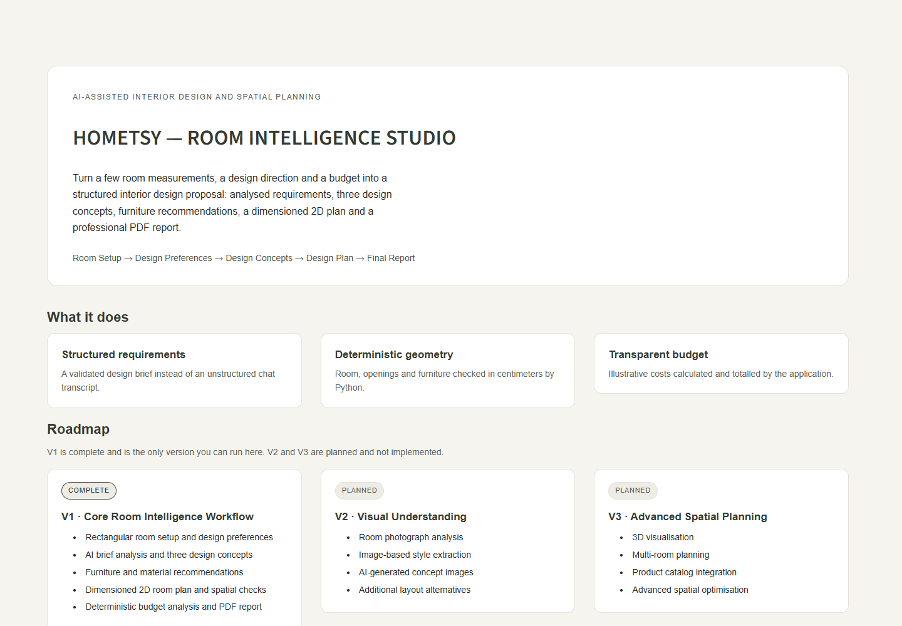
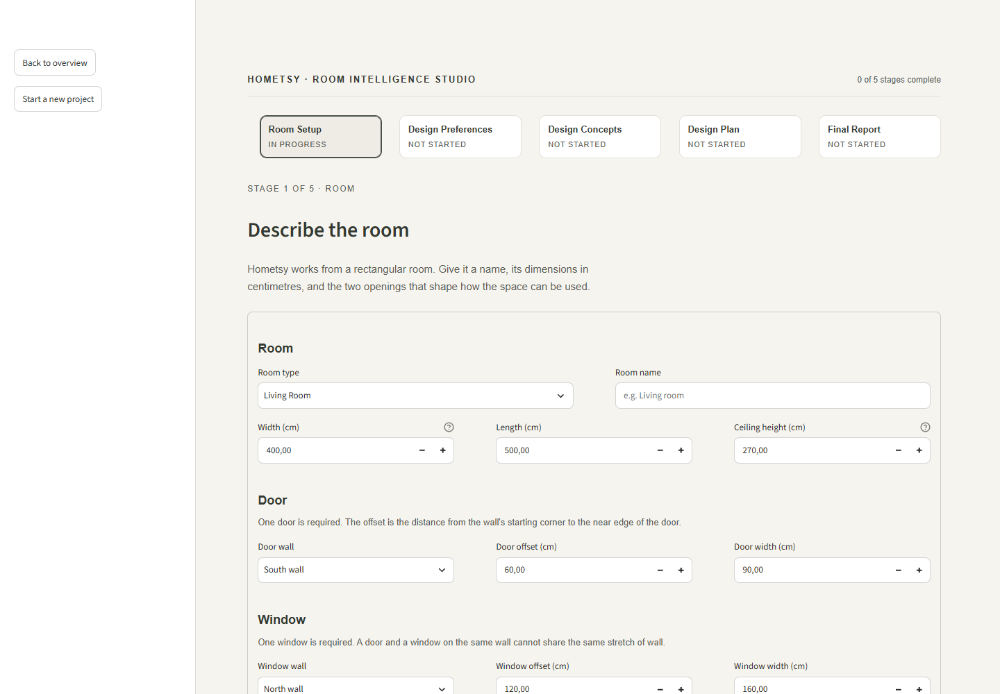
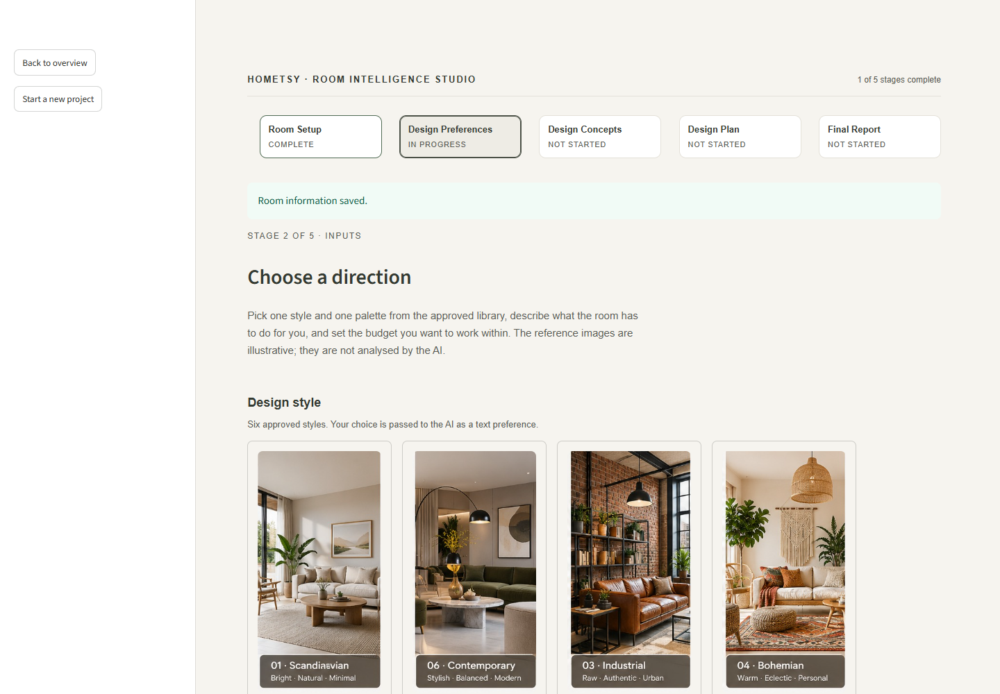
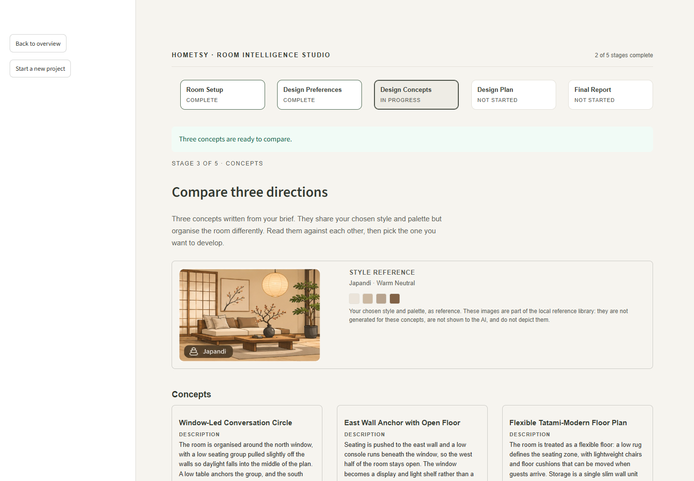
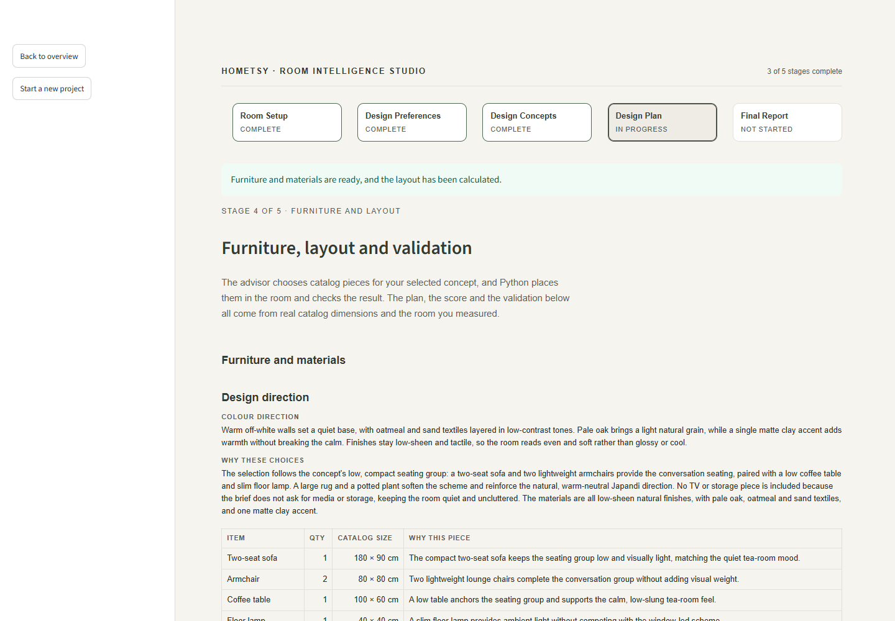
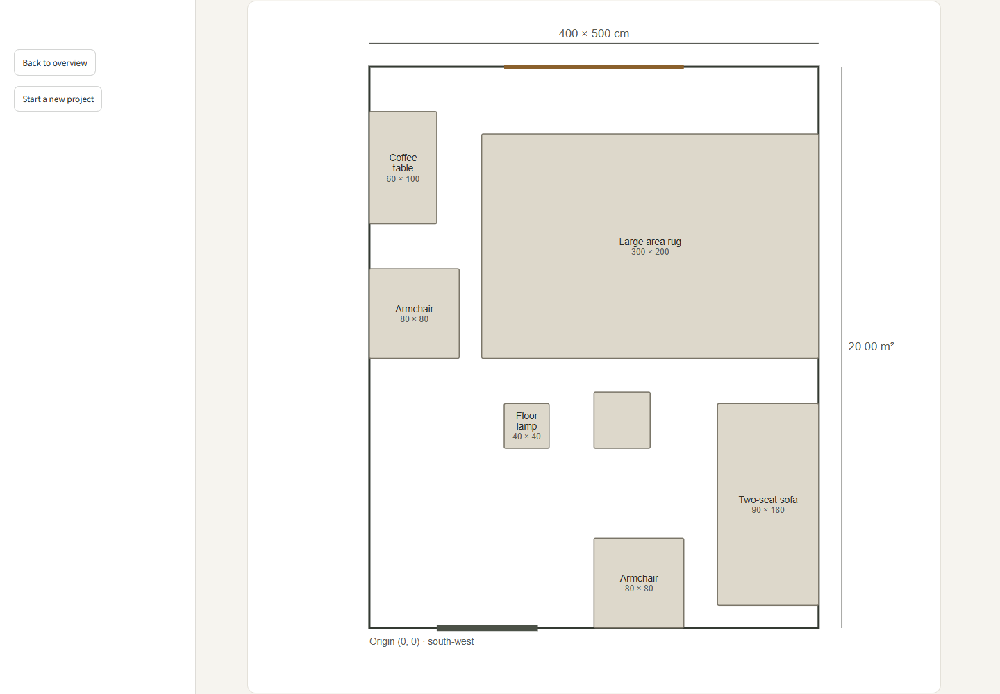
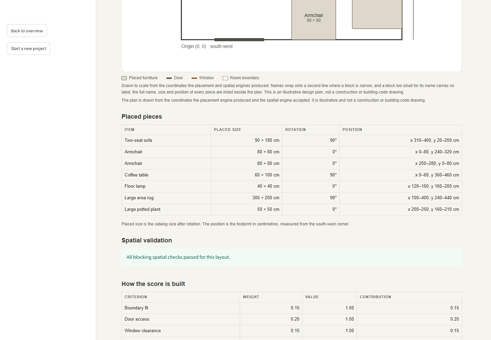
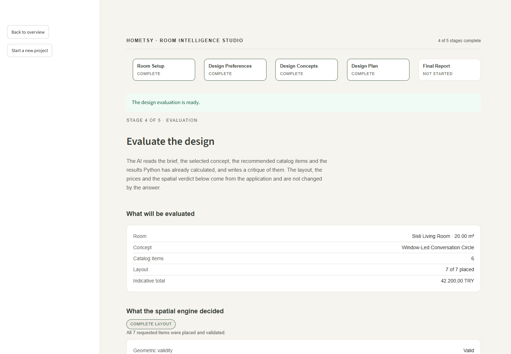
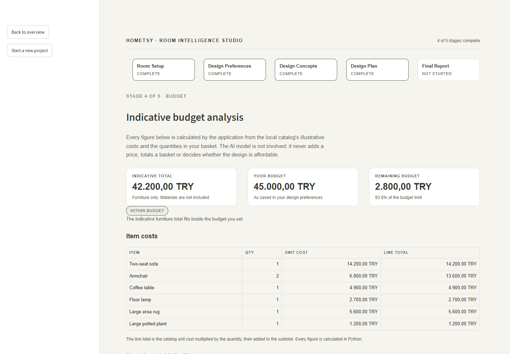
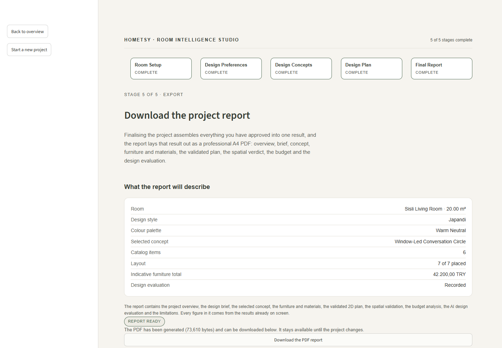

# HOMETSY — Room Intelligence Studio

## Portfolio case study

HOMETSY is a working V1 application, built alone as a portfolio project. This
document explains what it does, how it is built, and where the interesting
engineering decisions are. Every screenshot below is a capture of the running
application; nothing here is a mockup, and no user, customer, revenue or
production-traffic claim is made.

---

## 1. Overview

HOMETSY turns a few room measurements, a design direction and a budget into a
structured interior design proposal: a validated brief, three design concepts,
furniture recommendations from a local catalog, a dimensioned 2D floor plan
checked against the room's geometry, a deterministic budget, and a professional
PDF report.

- **Type:** single-user Streamlit application, run locally
- **Scope:** one rectangular residential room per project
- **Status:** V1 complete; 1,149 automated tests passing
- **Purpose:** portfolio demonstration, not a commercial product

The product question it explores is narrow and useful: *can a language model do
the design reasoning while Python keeps every number honest?*

---

## 2. Problem and objective

Interior design advice from a chat model is fluent and unaccountable. It will
happily suggest a 220 cm sofa for a 180 cm wall, total a budget it invented, and
describe a layout that no geometry engine ever checked. The failure is not
tone — it is that prose has no obligation to be true about measurements.

HOMETSY's objective was therefore not "an AI interior designer". It was a
demonstration of a specific engineering discipline:

> Let the model interpret, propose and critique. Let Python measure, place,
> check, price and draw. Never let the first override the second.

Concretely, that means the model never sees a coordinate, never computes an
area, never decides whether furniture fits, and never produces the final total.
Every one of those is deterministic code with tests.

### Scope was deliberately bounded

V1 supports one rectangular room, four room types, six design styles, four
palettes, one local catalog of 20 items, and a fixed five-stage workflow.
Excluded on purpose: 3D, vision models, AI-generated imagery, irregular
geometry, retailer pricing, accounts, databases and multi-room projects. The
constraint is the point — a complete, tested, honest V1 rather than an
ambitious unfinished one.

---

## 3. User workflow

Five stages, shown in the application shell on every screen:

| Stage | User action | What the system does |
|---|---|---|
| **1 · Room Setup** | Room type, name, dimensions, ceiling height, one door, one window | Range-checks every field; the door and window must sit inside their wall and not overlap each other |
| **2 · Design Preferences** | Style, palette, requirements, optional materials, budget limit | Stores validated input; no AI call |
| **3 · Design Concepts** | Press *Analyse the brief*, then *Generate three concepts*, then select one | Two model calls, each schema-validated; the concept set must be exactly three and distinct |
| **4 · Design Plan** | Press *Recommend furniture and build the plan* | One model call for catalog IDs, then Python places every item, validates geometry, scores the layout, and prices the basket |
| **5 · Final Report** | Press *Evaluate the design*, then *Generate the PDF report* | One model call for the critique; Python assembles the A4 PDF from stored results |

Between stages 2 and 3 the user passes a **project review** screen that shows
exactly what the next AI call will receive. Nothing is sent to a model until the
user presses an AI button.

---

## 4. System architecture

One Streamlit process. Layers depend downward, and only `ui` imports Streamlit.

```
app.py                      entry point and screen routing
│
├── ui/                     presentation and Streamlit adaptation
│   ├── shell.py            brand bar, stage strip, stage vocabulary
│   ├── theme.py            the single stylesheet and colour tokens
│   ├── session.py          one WorkflowState per browser session
│   ├── pages_*.py          one module per screen
│   ├── diagram.py          room and plan SVGs
│   ├── ai_actions.py       the only place AI services are invoked
│   └── commits.py          validate → store → invalidate downstream
│
├── workflow/               state machine (no Streamlit)
│   ├── state.py            WorkflowState, completion, invalidation
│   └── dependencies.py     what each step depends on
│
├── core/                   deterministic engines (no Streamlit, no AI)
│   ├── room_engine.py      room geometry and openings
│   ├── placement_engine.py furniture placement
│   ├── spatial_engine.py   boundary, overlap, access, circulation
│   ├── budget_engine.py    Decimal arithmetic over the catalog
│   └── report_generator.py the A4 PDF (ReportLab)
│
├── ai/                     model access (no Streamlit)
│   ├── client.py           HTTP transport, typed errors
│   ├── prompt.py           prompt assembly and schema enforcement
│   ├── parsing.py          structured-output parsing and repair
│   └── *_analyzer.py, *_generator.py, *_advisor.py, *_evaluator.py
│
├── models/schemas.py       Pydantic models shared by every layer
├── data/                   catalog and reference library (JSON)
└── tests/                  1,149 tests
```

The dependency rule is enforceable and enforced: `core`, `ai`, `models` and
`workflow` never import Streamlit, and one test runs the whole deterministic
workflow in a child process with an empty module table to prove the AI layer is
not imported at all.

### State is derived, not flagged

A step is complete only when its own data exists **and** its prerequisites are
complete. Completion is computed from the data, never stored as a boolean, so
editing the budget cannot leave a stale "complete" marker behind: the dependent
results are cleared and the derived state reflects the clearing.

| Change | Invalidates |
|---|---|
| Room dimensions, door or window | Brief, concepts, selection, plan, evaluation, budget |
| Style, palette, requirements, materials | Brief, concepts, selection, plan, evaluation, budget |
| Budget limit | Budget analysis |
| Concept selection | Plan, evaluation, budget |
| Recommended furniture | Plan, evaluation, budget |

---

## 5. Important engineering decisions

### The model proposes; Python verifies

The furniture step is the clearest example. The model returns catalog item IDs
and quantities — never coordinates. Python then:

1. resolves every ID against the catalog, rejecting unknown items rather than
   substituting a similar one;
2. places each item using its **real catalog dimensions**;
3. applies rotation and re-derives the footprint;
4. checks boundary fit, pairwise overlap, door access and window clearance;
5. scores the layout heuristically;
6. prices the basket with `Decimal`.

If a single ID is invalid the screen says the basket cannot be used and shows
the request unmodified. It does not silently drop the item.

### Failure is a state, not an exception

Every AI response is parsed into a Pydantic model. A missing field, wrong type,
duplicate concept, unknown catalog ID, timeout or truncated response is a typed
error surfaced on screen. Nothing invalid is stored, and a failed call is never
rendered as a successful result.

The suite mocks all four AI operations, so tests never need a key or a network.

### Money is `Decimal`, never `float`

Unit costs come from the catalog, quantities multiply them, and subtotal, total,
remaining budget and overrun are `Decimal` arithmetic. No float rounding is
allowed anywhere in the path, and a test asserts the total is reproducible from
the stored basket.

### Assets are local and licensed

All reference images are original AI-generated reference sheets created for this
project — no third-party stock. The text-only model never receives the images;
only their descriptions are sent. The application does not claim image analysis.

### One stylesheet, one component vocabulary

`ui/theme.py` holds the entire stylesheet and the colour tokens, and the PDF
palette is asserted equal to the UI palette by a test, so screen and document
cannot drift. Pages compose helpers instead of hand-writing markup.

---

## 6. AI integration approach

The model is used for exactly four operations:

| Operation | Model produces | Python then |
|---|---|---|
| Brief analysis | Structured summary: priorities, constraints, open questions, risks | Validates the schema and stores it |
| Concept generation | Three concepts: name, direction, materials, furniture approach, rationale | Validates count, distinctness and plausibility |
| Furniture recommendation | Catalog IDs, quantities, a reason per item, material notes | Checks every ID, places, validates geometry, prices |
| Design evaluation | A structured critique: compatibility, consistency, suitability, limitations | Keeps the layout, score and prices it computed |

Design choices in the integration:

- **Text-only model, text-only input.** No vision capability is claimed.
- **Explicit request disclosure.** The review and brief screens list what will be
  sent, before it is sent.
- **One call per operation, user-triggered.** Opening a screen makes no request.
- **Schema-first prompts.** The prompt states the required shape; the parser
  enforces it and reports what was wrong.
- **The credential never leaks.** It is read from the environment, excluded from
  `repr`, and scrubbed from error messages.

---

## 7. Deterministic geometry and budget engines

### Geometry

All internal measurement is centimetres, origin at the room's south-west corner,
`x` to the east and `y` to the north. Area is only converted to square metres at
the presentation boundary.

The spatial engine answers a small, closed set of questions and refuses to imply
more:

- does each footprint lie inside the room boundary?
- do any two footprints overlap?
- is the door approach obstructed?
- is the window band kept reasonably clear?
- a heuristic circulation score, explicitly labelled as heuristic

The interface and the PDF both state that this is **not** ergonomic,
accessibility, structural or building-code compliance, and that the plan is
illustrative rather than a construction drawing.

### Budget

`core/budget_engine.py` is the only module that prices anything. It multiplies
catalog unit cost by quantity, sums `Decimal` line totals, subtracts from the
budget limit and reports an overrun when negative. An unpriced item is reported
as unpriced — never costed at zero. Materials have no price list in V1, so they
are listed as *not priced* and excluded from the furniture total, and the screen
says so.

Catalog costs are explicitly **indicative**: illustrative figures for a portfolio
project, not verified market prices and not retailer data.

---

## 8. QA evidence and test results

### Automated suite

```
1,149 passed, 0 failed, 0 skipped   (~74 s)
```

1,123 tests existed at the end of Phase 8; 26 were added during this review to
pin the heading structure, for 1,149. The suite covers schemas, all four
deterministic engines, the AI layer with mocked responses, workflow
invalidation, every screen through Streamlit's own `AppTest` harness, and the
generated PDF.

The AI tests use recorded and constructed responses: **the suite never requires
a live API key and makes no network call.**

### Mutation checks

Fixes in this project are verified by reverting them and confirming the tests
fail. The heading fix was checked this way: restoring the old `<p>` section
labels and the `h2` page title failed 8 of the new tests; removing the CSS rule
that preserves the original presentation failed the CSS invariant test.

### Accessibility evidence

- **axe-core 4.10.2:** zero violations across nine screens.
- **Axe's heading rule is unreliable in 4.10.2.** `page-has-heading-one`
  reported a pass on a page with zero `h1` elements, so the zero-violation
  result was never evidence about headings. This was found during this review and
  is recorded rather than hidden.
- **Heading structure is now asserted directly.** A new test module,
  `tests/test_ui_headings.py`, drives all nine screens and asserts one `h1` per
  screen, no skipped levels, real `h2`/`h3` section headings, no empty headings,
  and that pages never hand-write a heading tag.
- **No screen-reader listening session has been performed.** NVDA is not
  installed on the development machine and was deliberately not installed for
  this review. The accessibility tree a screen reader consumes was inspected
  directly; that inspection found the heading defect described above, which was
  fixed. This is structural evidence, not a substitute for listening, and no
  screen-reader compatibility or WCAG conformance is claimed.

### Responsive evidence

Measured in a real browser at 1440, 1024, 768, 430, 404, 390 and 360 px: the page
never scrolls horizontally at any of those widths. On narrow screens the plan
drawing keeps full scale and scrolls inside its own focusable frame rather than
shrinking its labels below legibility.

### PDF evidence

The report was generated twice from live runs during Phase 8 (73,610 B and
74,948 B, 13 pages) and once more during this review (74,769 B, 13 pages). The
extracted text contains all ten sections — overview, brief, concept, furniture
and materials, validated plan, spatial validation, budget analysis, AI design
evaluation, limitations and disclaimer.

---

## 9. Screenshots

All images are captures of the running application at 1440 px wide. The
portfolio selection lives in `docs/screenshots/portfolio/`; the full 20-image
collection remains in `docs/screenshots/`.

| Screenshot | Shows |
|---|---|
|  | **Product identity and roadmap.** The five-stage journey, what the tool does, and an honest V1/V2/V3 roadmap. |
|  | **Room definition.** Centimetre input with in-form door and window placement and a live layout preview. |
|  | **Design preferences.** Six styles and four palettes from a local reference library, plus requirements and budget. |
|  | **AI design concepts.** Three distinct directions generated from the analysed brief, with the style reference captioned as illustrative. |
|  | **Furniture recommendations.** Model-chosen catalog pieces with catalog size and a reason per item. |
|  | **2D plan.** Drawn to scale from real coordinates and catalog dimensions, rotation included, with the origin marked. |
|  | **Spatial validation.** Placed sizes, rotations, positions in centimetres and the engine's verdict. |
|  | **Design evaluation.** The AI critique beside the spatial and budget figures Python calculated. |
|  | **Budget analysis.** Indicative total, budget limit, remaining budget and per-item arithmetic. |
|  | **PDF report.** The generated A4 report, ready to download. |

Mobile layouts are included in the full collection as
[plan at 390 px](screenshots/19-plan-mobile-390.png) and
[budget at 390 px](screenshots/20-budget-mobile-390.png).

---

## 10. Limitations and roadmap

### Limitations (deliberate V1 boundaries)

- One rectangular room; no L-shapes, alcoves, columns or sloped ceilings.
- One project per session; no accounts, database or saved projects.
- Indicative catalog prices only; no live pricing or retailer integration.
- The 2D plan is illustrative, not a construction or building-code drawing.
- Basic geometric validation only: boundary, overlap, door access, window
  clearance and a heuristic circulation score. Not a compliance claim.
- Materials are not priced and are excluded from the furniture total.
- The model is text-only and cannot analyse photographs.
- Very small furniture blocks carry no label; their full details are in the
  table beneath the plan.
- No screen-reader listening session and no WCAG conformance claim.
- AI latency and truncation are reported as errors and can be retried.

### Roadmap

**V2 — Visual Understanding** *(planned, not implemented).* Room photograph
analysis, image-based style extraction, AI-generated concept imagery and
additional layout alternatives. These require a vision-capable model and an
image pipeline V1 deliberately lacks.

**V3 — Advanced Spatial Planning** *(planned, not implemented).* 3D
visualisation, multi-room planning, product catalog integration with live
pricing, and advanced spatial optimisation.

---

## 11. What this project demonstrates

- A working, tested Python application rather than a prototype or a notebook.
- A defensible boundary between probabilistic reasoning and deterministic
  engineering, enforced by module structure and by tests.
- Geometry and money implemented with real units, real dimensions and exact
  arithmetic.
- Structured AI output validated by schema, with failure handled honestly.
- A design system expressed as one stylesheet and a shared component vocabulary,
  with the PDF palette asserted equal to the UI palette.
- Accessibility work that includes finding and fixing its own false positive
  rather than reporting a green check.
- A 1,149-test suite that runs without an API key and covers every screen.

---

Built as a portfolio project. The interesting part is not that a model can write
about interior design — it is where the model stops and the engineering starts.
